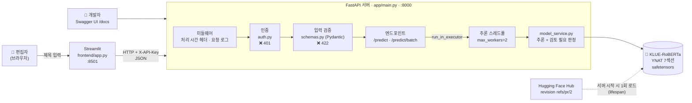
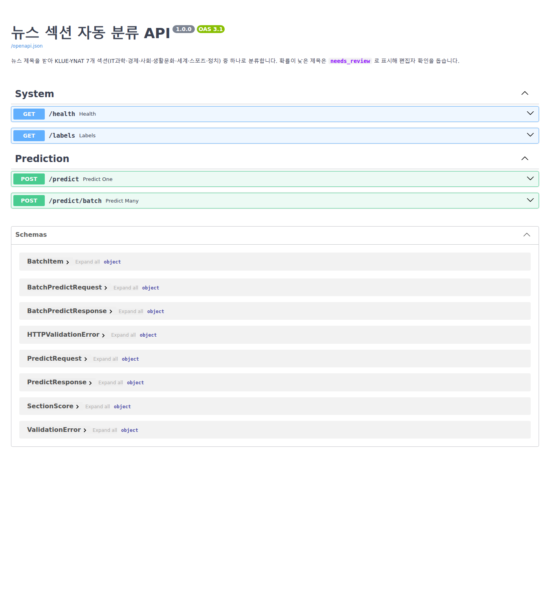
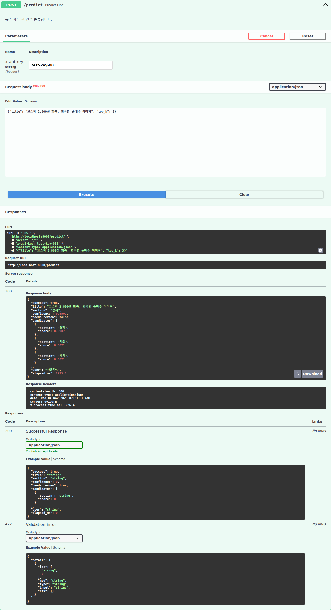
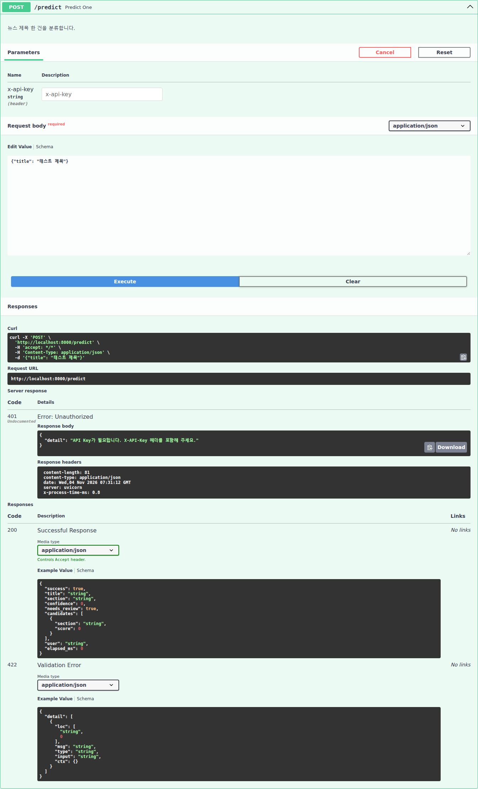
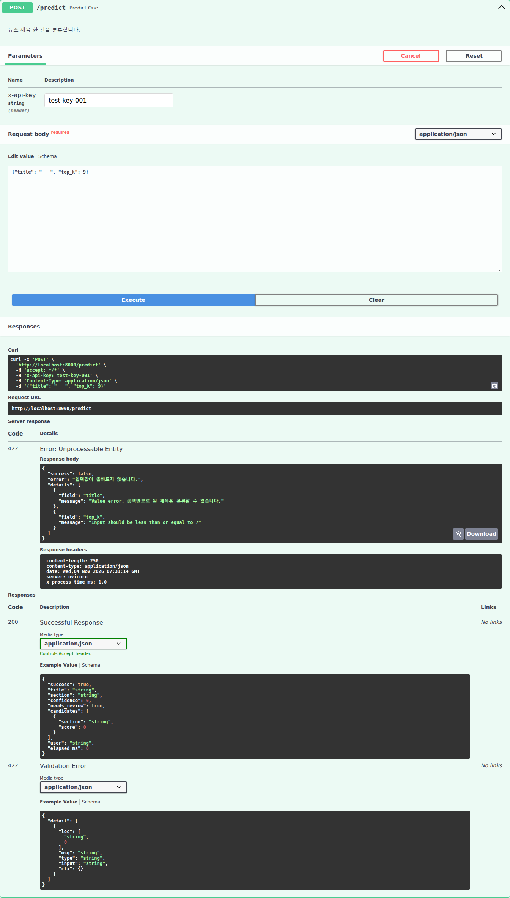
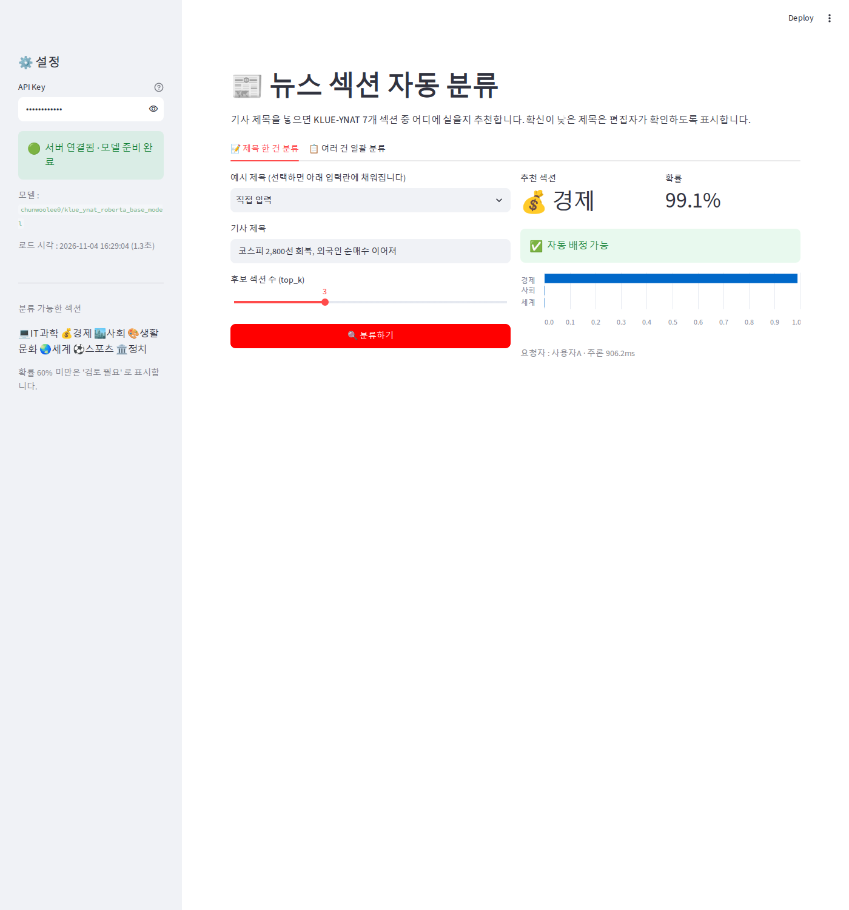
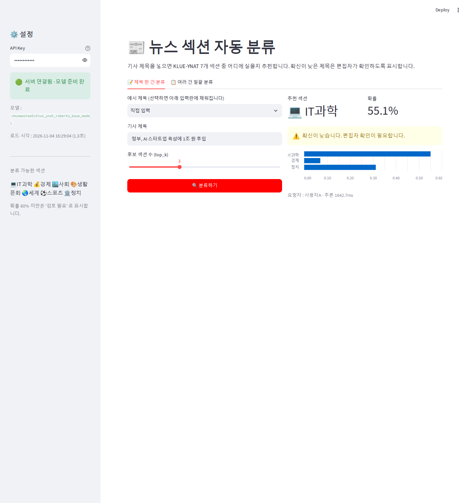
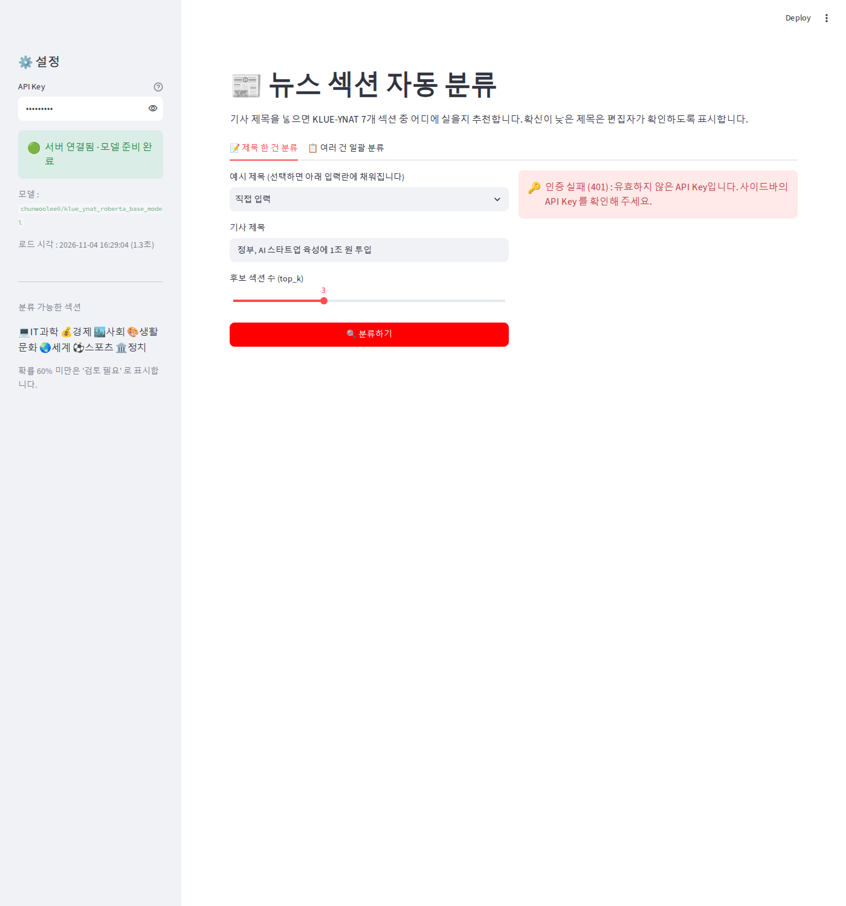
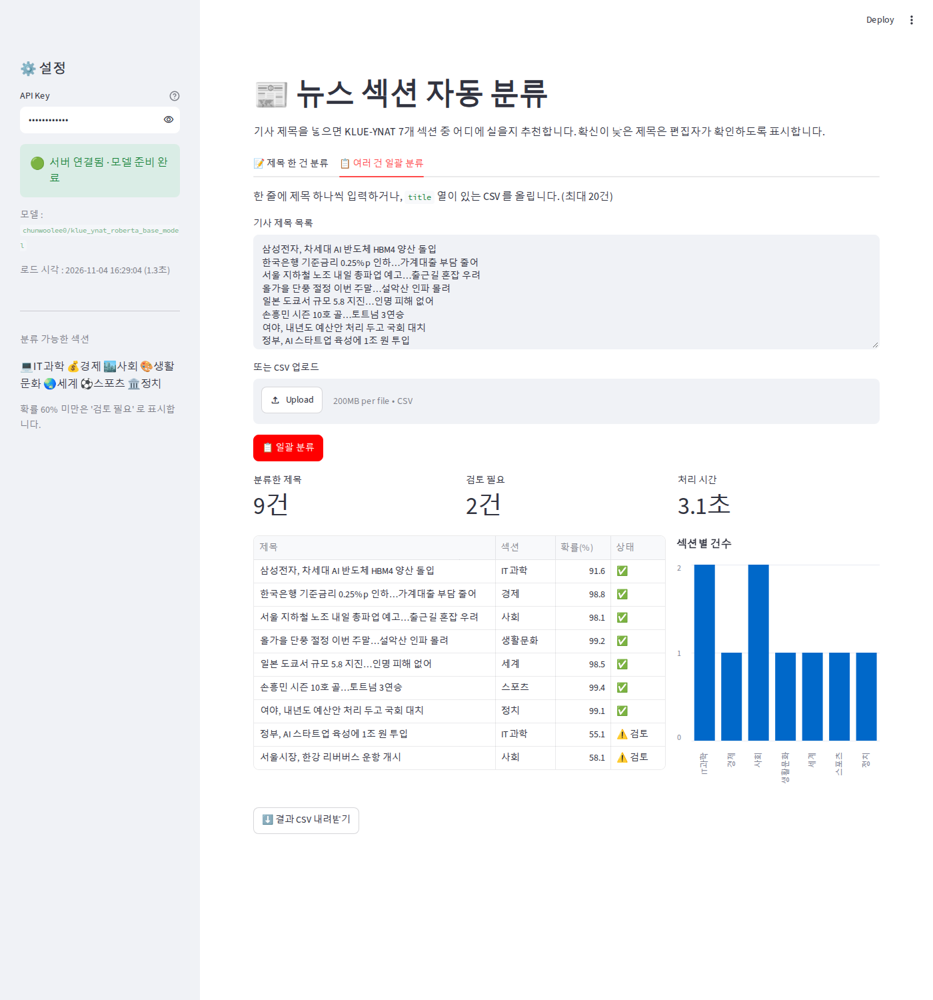

# 📰 뉴스 섹션 자동 분류 API

> 기사 제목을 넣으면 **어느 섹션에 실을지** 추천하고, 애매한 제목은 **편집자 검토**로 넘기는 모델 서빙 서비스

- 과정 : AIFFEL 기업 프라이빗 AI 과정 · 모델 서빙 D52 자율 프로젝트
- 모델 : [`chunwoolee0/klue_ynat_roberta_base_model`](https://huggingface.co/chunwoolee0/klue_ynat_roberta_base_model) (KLUE-RoBERTa-base · KLUE-YNAT, 443MB)
- 스택 : FastAPI · Pydantic v2 · Hugging Face Transformers · Streamlit
- 실행 환경 : WSL2 Ubuntu · Python 3.12 · **CPU 전용** (torch 2.4.1, transformers 4.57.6)

---

## 1. 프로젝트 소개

### 문제
언론사 편집국에는 하루에도 수백 건의 기사가 들어옵니다. 각 기사를 정치·경제·사회 같은 **섹션에 배정하는 일**은 단순하지만 반복적입니다. 그런데 "정부, AI 스타트업 육성에 1조 원 투입"처럼 여러 섹션에 걸치는 제목은 사람이 판단해야 합니다.

### 해결
기사 **제목**만으로 KLUE-YNAT 7개 섹션 중 하나를 추천하는 API 를 만들었습니다.
섹션은 **IT과학 · 경제 · 사회 · 생활문화 · 세계 · 스포츠 · 정치** 입니다.

| 기능 | 설명 |
|---|---|
| 단건 분류 `POST /predict` | 제목 1건 → 추천 섹션, 확률, 상위 후보(top_k) |
| **검토 필요 표시** | 1위 확률이 **60% 미만**이면 `needs_review: true` → 편집자에게 넘김 |
| **일괄 분류** `POST /predict/batch` | 제목 최대 20건 → 건별 결과 + 섹션별 건수 + 검토 필요 건수 |
| 화면 | 한 건 분류 탭, 일괄 분류 탭 (CSV 업로드 · 결과 CSV 내려받기) |

### 모델 선택 이유
허브에 있는 KLUE-YNAT 모델 3개를 **직접 만든 뉴스 제목 14건(섹션별 2건)** 으로 비교해 골랐습니다.

| 모델 | 정답 | 판단 |
|---|---|---|
| `chunwoolee0/klue_ynat_roberta_base_model` | **14/14** | 라벨이 한국어(`IT과학` 등)라 후처리 불필요 → **선택** |
| `kakarooky/roberta-base-klue-ynat-classification` | 14/14 | 라벨이 `LABEL_0~6` 이라 별도 매핑 필요 |
| `Doowon96/roberta-base-finetuned-ynat_bench` | 6/14 | 정확도 부족 |

과제 조건(CPU 환경 500MB 이하)을 만족하고, 한 건 추론에 **약 0.05~1초**가 걸립니다.

---

## 2. 시스템 아키텍처



**요청 한 건의 흐름**

1. 편집자가 Streamlit 에 제목을 입력하면, Streamlit 이 `X-API-Key` 헤더를 붙여 `POST /predict` 를 호출합니다.
2. **인증**에서 키가 없거나 틀리면 `401` 을 돌려줍니다.
3. **검증**에서 제목 길이, `top_k` 범위, 공백만 있는 제목을 확인합니다. 위반하면 추론 전에 `422` 를 돌려줍니다.
4. **추론**은 동기 함수라서 `run_in_executor` 로 별도 스레드에서 실행합니다. 그동안에도 이벤트 루프는 다른 요청과 `/health` 에 응답합니다.
5. **판정**에서 1위 확률이 0.6 미만이면 `needs_review: true` 를 붙입니다.
6. Streamlit 이 결과를 받아 섹션, 확률, 후보 막대그래프, 검토 경고를 표시합니다.

**상태 코드 설계**

| 코드 | 상황 | 응답 예 |
|---|---|---|
| 200 | 정상 | `{"section": "경제", "confidence": 0.9907, "needs_review": false, ...}` |
| 401 | API Key 없음 · 틀림 | `{"detail": "유효하지 않은 API Key입니다."}` |
| 422 | 입력 규격 위반 | `{"error": "입력값이 올바르지 않습니다.", "details": [{"field": "top_k", "message": "..."}]}` |
| 503 | 모델 로드 전 | `{"detail": "모델을 불러오는 중입니다. ..."}` |
| 500 | 예상 못 한 오류 | `{"error": "서버 내부 오류가 발생했습니다."}` (상세는 서버 로그에만) |

---

## 3. 각 부품 구성

```
Serving01/
├── app/
│   ├── auth.py            # ① 인증
│   ├── schemas.py         # ② 입출력 규격
│   ├── model_service.py   # ③ 모델 로드 · 추론
│   └── main.py            # ④ FastAPI 서버
├── frontend/
│   └── app.py             # ⑤ Streamlit 화면
├── klue_ynat_roberta_base_model.ipynb   # 모델 검증 → 파일 생성 → 서버 기동 → 테스트 전 과정 (실행 결과 포함)
├── screenshots/           # 결과 캡처
└── requirements.txt
```

### ① `app/auth.py` — API Key 인증
- 이전 실습의 인증 모듈을 그대로 재사용했습니다.
- `X-API-Key` 헤더를 확인해서 사용자 이름을 돌려줍니다. 키가 없거나 틀리면 `401` 입니다.
- 실습용 키 : `test-key-001`, `test-key-002`
- 엔드포인트에는 `Depends(verify_api_key)` 한 줄로 붙입니다.

### ② `app/schemas.py` — 입출력 규격 (Pydantic v2)
| 스키마 | 규칙 |
|---|---|
| `PredictRequest` | `title` 2~200자, **공백만 있는 제목 차단**, `top_k` 1~7 (기본 3) |
| `BatchPredictRequest` | `titles` 1~20건, 각 제목 2~200자 |
| `PredictResponse` | `section`, `confidence`, `needs_review`, `candidates[]`, `user`, `elapsed_ms` |
| `BatchPredictResponse` | `results[]`, `section_counts`, `review_count`, `elapsed_ms` |

- **공백 처리** : 공백만 있는 문자열(`"     "`)은 `min_length` 를 통과합니다. 그래서 `field_validator` 로 `strip()` 한 뒤 다시 검사합니다.
- **길이 상한** : 모델은 **제목**으로 학습되었습니다. 본문을 넣으면 비용만 늘고 정확도는 오르지 않으므로, 200자 상한을 서비스 정책으로 두었습니다.

### ③ `app/model_service.py` — 모델 로드 · 추론
- `load_model()` : `pipeline("text-classification", revision="refs/pr/2", top_k=None)` 로 7개 섹션 확률을 모두 받습니다.
- `predict()` : 제목 1건을 분류하고, 1위 확률이 `REVIEW_THRESHOLD`(0.6)보다 낮으면 검토 필요로 표시합니다.
- `predict_batch()` : 리스트를 파이프라인에 한 번에 넘겨(`batch_size=8`) 처리하고, 섹션별로 집계합니다.
- 모델 이름, revision, 기준값은 환경 변수(`NEWS_MODEL_ID`, `NEWS_MODEL_REVISION`, `NEWS_REVIEW_THRESHOLD`)로 바꿀 수 있습니다.

### ④ `app/main.py` — FastAPI 서버
| 엔드포인트 | 인증 | 설명 |
|---|---|---|
| `GET /health` | 없음 | 서버·모델 상태 (`healthy` / `loading`), 로드 시각 |
| `GET /labels` | 없음 | 섹션 목록, 검토 기준값 |
| `POST /predict` | 필요 | 단건 분류 |
| `POST /predict/batch` | 필요 | 일괄 분류 (최대 20건) |

- **lifespan** : 서버 시작 시 모델을 한 번만 올립니다. 로드에 실패해도 서버는 뜨고, `/health` 는 `loading`, 추론은 `503` 을 돌려줍니다.
- **run_in_executor** : 추론 전용 `ThreadPoolExecutor(max_workers=2)` 를 씁니다. 일괄 요청 120제목이 도는 중에도 `/health` 가 **7ms** 만에 응답했습니다.
- **에러 핸들러** :
  - `RequestValidationError` 는 필드별 한국어 메시지로 바꿔 돌려줍니다.
  - 그 밖의 예외는 내부 정보를 숨기고 `500` 만 돌려줍니다.
- **미들웨어** : 모든 응답에 `X-Process-Time-ms` 헤더를 붙이고 요청 로그를 남깁니다.

### ⑤ `frontend/app.py` — Streamlit 화면
- **사이드바** : API Key 입력, 서버 연결 상태(`/health`), 섹션 목록
- **📝 한 건 분류 탭** : 예시 제목 선택 또는 직접 입력 → 추천 섹션, 확률, 후보 막대그래프, 검토 경고
- **📋 일괄 분류 탭** : 여러 줄 입력이나 CSV(`title` 열) 업로드 → 결과 표, 섹션별 건수 차트, 결과 CSV 내려받기
- **오류 안내** : 상태 코드마다 안내 문구가 다릅니다. 401 은 키 확인, 422 는 필드별 오류, 503 은 로딩 중, 연결 실패는 서버 실행 안내입니다.

---

## 4. 결과 스크린샷

### Swagger UI
| 엔드포인트 목록 | 정상 추론 (200) |
|---|---|
|  |  |

| API Key 없음 (401) | 잘못된 입력 (422) — 공백 제목 + `top_k: 9` |
|---|---|
|  |  |

### Streamlit
| 한 건 분류 — 자동 배정 | 한 건 분류 — **검토 필요** (IT과학 55.1%) |
|---|---|
|  |  |

| 인증 실패 안내 | 일괄 분류 — 9건 중 검토 필요 2건 |
|---|---|
|  |  |

### 테스트 결과 요약 (노트북 실행 결과)
| 테스트 | 결과 |
|---|---|
| 모델 정확도 (직접 만든 제목 14건) | **14/14** |
| 정상 요청 | 200 · "코스피 2,800선 회복…" → 경제 0.99 |
| 검토 필요 | 200 · "정부, AI 스타트업 육성에 1조 원 투입" → IT과학 0.55 / 정치 0.31 → `needs_review: true` |
| 인증 실패 | 키 없음 401 · 틀린 키 401 |
| 입력 오류 | 필드 누락 · 1글자 · 공백만 · 201자 · `top_k` 9 · JSON 아님 · 일괄 21건 → **모두 422** |
| 동시 요청 | 일괄 6건(120제목) 동시 → 전부 200, 처리 중 `/health` 7ms 응답 |
| Streamlit 화면 | `streamlit.testing` 으로 단건 · 401 · 일괄 시나리오 자동 확인, 예외 0건 |

---

## 5. 실행 방법

```bash
pip install -r requirements.txt   # torch 는 CPU 판 : --index-url https://download.pytorch.org/whl/cpu

# 터미널 1 : 백엔드 (첫 실행 시 모델 443MB 다운로드)
uvicorn app.main:app --port 8000

# 터미널 2 : 프론트
streamlit run frontend/app.py --server.port 8501
```

| 확인 | URL |
|---|---|
| 프론트 (Streamlit) | http://localhost:8501 |
| Swagger UI | http://localhost:8000/docs |
| 헬스체크 | http://localhost:8000/health |

---

## 6. 회고 (KPT)

### 🟢 Keep — 잘한 점, 계속할 것
- **모델을 고르기 전에 직접 검증했습니다.** 다운로드 수나 이름 대신, 직접 만든 제목 14건으로 후보 3개를 비교했습니다. 결과는 14/14, 14/14, 6/14 로 크게 갈렸습니다.
- **모델 점수를 서비스 판단으로 바꿨습니다.** 확률을 그대로 보여 주는 대신 "자동 배정 / 편집자 검토" 로 나눠서, 실제 업무 흐름에 맞췄습니다.
- **실패 경로부터 설계했습니다.** 401 · 422 · 503 · 500 을 먼저 정했습니다. 422 는 필드별 한국어 메시지로 바꿔 화면에서도 그대로 안내합니다.
- **단계마다 확인하며 진행했습니다.** 노트북 단건 추론 → 스키마 → 추론 모듈 → 서버 → Swagger → Streamlit 순서로, 각 단계를 실행해 보고 다음으로 넘어갔습니다.

### 🔴 Problem — 어려웠던 점, 아쉬운 점
- **torch 2.4.1 에서 모델이 열리지 않았습니다.**
  - 고른 모델의 저장소에는 `pytorch_model.bin` 만 있었습니다.
  - transformers 가 `torch.load` 취약점(CVE-2025-32434) 때문에 torch 2.6 미만에서는 `.bin` 로드를 막습니다.
  - 과정 환경을 바꿀 수 없어서, 허깅페이스 변환 봇이 올려 둔 **safetensors 판 PR 브랜치를 `revision="refs/pr/2"` 로 지정**해 해결했습니다.
- **공백만 있는 제목이 검증을 통과했습니다.** `min_length=2` 만으로는 `"     "` 를 막지 못해서, `field_validator` 로 `strip()` 후 다시 검사하도록 바꿨습니다.
- **검토 기준값 0.6 은 근거가 약합니다.** 애매한 제목 몇 건을 보고 정한 값이라, 실제 편집 데이터로 다시 정해야 합니다.
- **라이선스를 확인하지 못했습니다.** 모델 카드에 라이선스 표기가 없어서, 지금은 학습 목적으로만 사용합니다.

### 🔵 Try — 다음에 시도할 것
- 모델을 고를 때 **저장 형식(safetensors 여부)과 내 torch 버전**을 가장 먼저 확인하겠습니다.
- 검증용 제목을 더 모아 **정밀도·재현율 곡선**을 보고 검토 기준값을 정하겠습니다.
- 운영으로 가려면 다음이 필요합니다.
  - API 키를 시크릿 저장소로 옮기고 해시로 저장
  - 키별 요청 제한
  - **모델을 포함한 Docker 이미지** (지금은 첫 기동 때 443MB 다운로드)
  - 게이트웨이 헬스체크
- 제목 외에 리드 문장까지 쓰는 모델, 또는 섹션 하위 분류(예 : 경제 > 증권)로 넓혀 보겠습니다.
