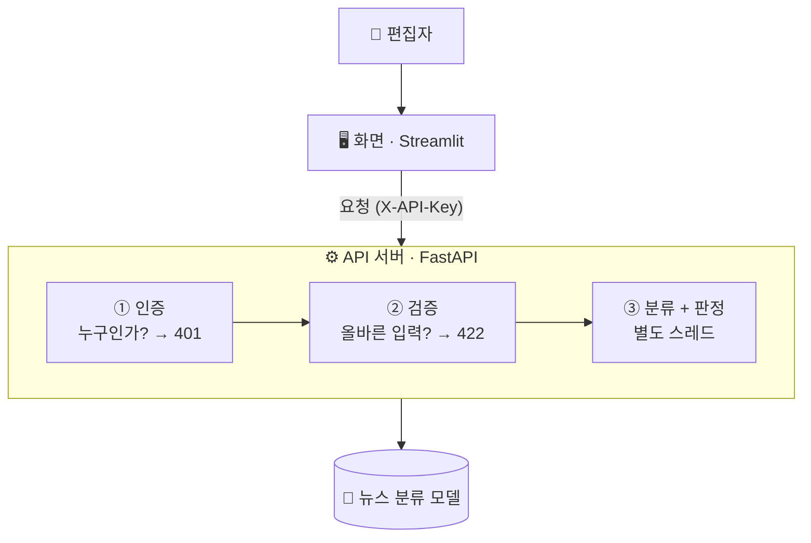

# 📰 뉴스 섹션 자동 분류 API

> 기사 제목을 넣으면 **어느 섹션에 실을지** 추천하고, 애매한 제목은 **편집자 검토**로 넘기는 서비스

📖 설계 근거·부품별 상세·전체 테스트 결과는 **[상세 문서 (README_DETAIL.md)](README_DETAIL.md)** 에 있습니다.

---

## 1. 프로젝트 소개

**한 줄 요약** : 허깅페이스의 한국어 뉴스 분류 모델을 **API 와 웹 화면으로 감싸서**, 누구나 쓸 수 있는 서비스로 만들었습니다.

- **무엇을** : 기사 제목 → 7개 섹션(IT과학 · 경제 · 사회 · 생활문화 · 세계 · 스포츠 · 정치) 중 하나 추천
- **왜** : 섹션 배정은 반복 업무지만, 여러 섹션에 걸친 제목은 사람이 봐야 합니다
- **핵심 아이디어** : 모델 확률을 그대로 보여 주지 않고 **업무 판단으로 바꿉니다**
  - 확률 60% 이상 → ✅ 자동 배정
  - 60% 미만 → ⚠️ 편집자 검토

**모델** : [`chunwoolee0/klue_ynat_roberta_base_model`](https://huggingface.co/chunwoolee0/klue_ynat_roberta_base_model)
- 연합뉴스 제목 데이터(KLUE-YNAT)로 학습된 모델입니다. 크기는 443MB 이고 CPU 로 돌아갑니다.
- 후보 3개를 직접 만든 제목 14건으로 비교해 골랐습니다. 이 모델은 14건을 모두 맞혔습니다.

## 2. 시스템 아키텍처

**개념으로 보면** : 서빙은 "모델을 요청-응답 서비스로 감싸는 일"입니다. 요청은 문 세 개를 차례로 지납니다.
1. **인증** : API 키가 없으면 들여보내지 않습니다.
2. **검증** : 빈 제목이나 너무 긴 제목은 모델에 닿기 전에 돌려보냅니다.
3. **추론** : 무거운 계산은 별도 스레드에서 돌립니다. 그래서 그동안에도 서버가 다른 요청에 응답합니다.

모델은 서버가 켜질 때 **한 번만** 불러옵니다. 요청마다 다시 읽지 않습니다.

## 3. 부품 구성

| 부품 | 역할 (비유) |
|---|---|
| `app/auth.py` | 출입증 확인 — API 키 검사 |
| `app/schemas.py` | 접수 양식 — 입력·출력의 형식과 허용 범위 |
| `app/model_service.py` | 실무자 — 모델을 불러와 분류하고 검토 여부 판정 |
| `app/main.py` | 창구 — 위 부품을 엮어 `/predict`, `/predict/batch` 로 공개 |
| `frontend/app.py` | 안내 데스크 — 사람이 쓰는 웹 화면 (한 건 / 여러 건 분류) |
| `news_classify.ipynb` | 작업 일지 — 모델 검증부터 테스트까지 실행 결과 전체 |

## 4. 결과 스크린샷

| 확신 높음 → 자동 배정 | 확신 낮음 → 편집자 검토 (IT과학 55%) |
|---|---|
|  |  |

| 여러 건 한 번에 분류 | 잘못된 입력은 모델 전에 차단 (422) |
|---|---|
|  |  |

**검증 결과** : 정상 200, 키 없음 401, 잘못된 입력 7종은 모두 422 였습니다. 동시 요청 120건도 전부 처리했습니다.

**실행** : `uvicorn app.main:app` → http://localhost:8000/docs · `streamlit run frontend/app.py` → http://localhost:8501

## 5. 회고 (KPT)

- 🟢 **Keep**
  - 모델은 이름이 아니라 **내 데이터로 직접 비교**해서 골랐습니다.
  - 모델 점수를 **업무 판단**으로 바꿨습니다.
- 🔴 **Problem**
  - 과정 환경(torch 2.4.1)에서 모델 파일이 열리지 않았습니다.
  - 허깅페이스의 **safetensors 변환 브랜치를 지정**해 해결했습니다.
- 🔵 **Try**
  - 검토 기준(60%)을 실제 데이터로 다시 정하겠습니다.
  - 모델을 Docker 이미지에 담아 배포하겠습니다.
