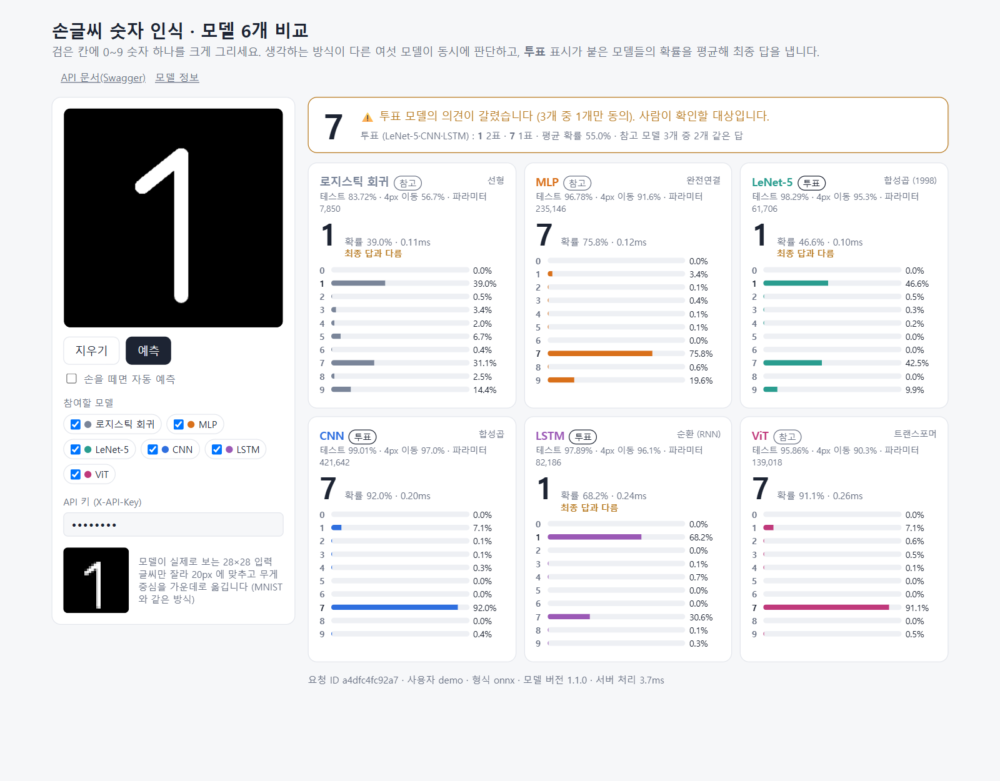
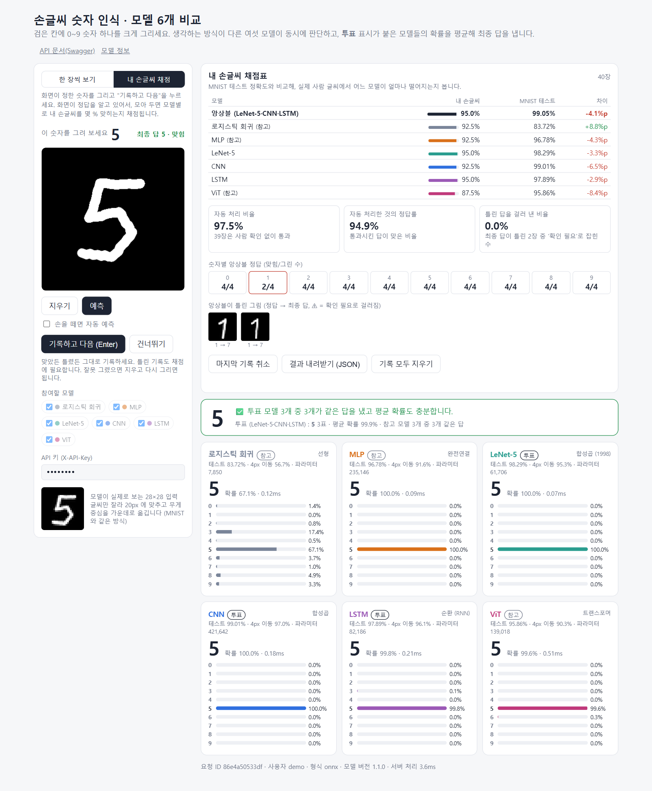
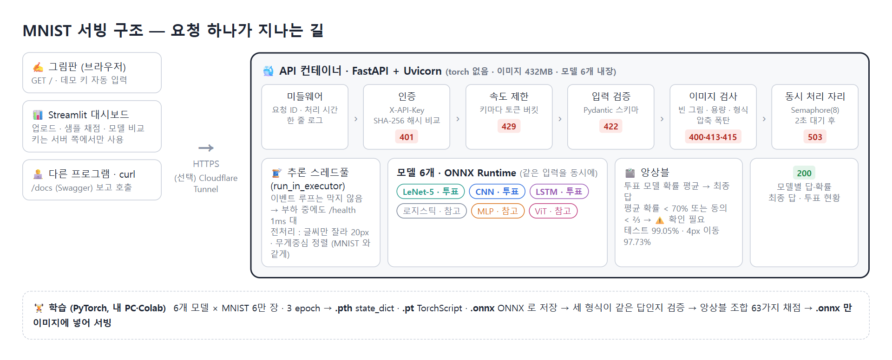
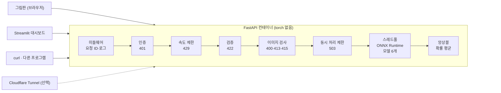

# MNIST 손글씨 인식 서빙 — 모델 6개 비교와 앙상블

[](https://github.com/stella1298/AIFFEL_Quest_EPA/actions/workflows/serving02-tests.yml)

구조가 다른 여섯 모델을 같은 조건으로 학습했습니다. 선형, MLP, 합성곱 2종, LSTM, 트랜스포머입니다. 그리고 **어떤 모델을 서비스에 쓸지 수치로 정해** API로 서빙했습니다.

최종 답은 세 모델이 확률을 평균해 냅니다. 확신이 낮거나 의견이 갈린 입력은 자동으로 처리하지 않고 **사람이 확인할 대상**으로 넘깁니다.


*깃발 달린 1을 그렸을 때. 투표 모델 셋 중 둘은 1, CNN은 7이라고 했지만 CNN의 확신(92%)이 커서 확률 평균으로는 7이 됩니다. 동의가 ⅓뿐이라 '확인 필요'로 분류됩니다.*

---

## 요약

| | |
|---|---|
| 문제 | 손글씨 숫자 이미지 → 0~9 분류, 틀릴 가능성이 높은 입력은 사람에게 넘기기 |
| 모델 | 로지스틱 회귀 · MLP · LeNet-5 · CNN · LSTM · ViT (PyTorch로 직접 학습) |
| 서빙 | FastAPI + ONNX Runtime (torch 없는 432MB 이미지), 그림판 웹 화면, Streamlit 대시보드 |
| 결과 | 앙상블 정확도 99.05%, 4px 이동한 입력 97.73% (단일 최고 CNN 99.01% · 96.97%) |
| 실측 | 직접 그린 손글씨 49장 : 앙상블 95.9% (MNIST 대비 -3.1%p), 틀린 2장 모두 '확인 필요'로 걸러짐 |
| 품질 | pytest 34개, GitHub Actions CI, 부하 테스트(동시 64 요청 3,000건 전부 성공) |

## 주요 결정과 근거

### 1. 모델을 다 섞지 않았습니다
처음에는 여섯 모델의 확률을 모두 평균했습니다. 그런데 **98.87%로, CNN 하나(99.01%)보다 낮았습니다.** 약한 모델(로지스틱 83.72%, ViT 95.86%)이 평균을 끌어내렸습니다.

그래서 가능한 조합 63개를 모두 채점했습니다([training/ensemble_eval.py](training/ensemble_eval.py)).
- **LeNet-5 + CNN + LSTM** 이 원본·이동·회전 세 항목 모두 1위였습니다.
- 합성곱 2개와 순환 1개라서, 서로 다른 방식으로 틀리는 조합입니다.
- 이 셋만 **투표**합니다. 셋의 확률 평균이 최종 답이고, '확인 필요'도 이 셋으로만 판단합니다.
- 나머지 셋은 **참고**입니다. 섞으면 평균을 끌어내려 최종 답에서는 뺐지만, 모델마다 어떻게 다르게 보는지 비교하도록 그림판에 결과를 함께 보여 줍니다. 그림판 모델 카드의 '투표', '참고' 표시와 설명이 이것입니다.

> 조합을 테스트셋 점수로 골랐기 때문에 99.05%는 약간 낙관적인 수치입니다. 실제 서비스라면 검증셋을 따로 떼어 골라야 합니다.

### 2. 학습은 PyTorch, 서빙은 ONNX
- 모델마다 state_dict · TorchScript · ONNX 세 형식으로 내보냈습니다.
- 세 형식의 출력을 비교했더니 차이가 최대 0.0000054 였습니다. 같은 답을 낸다는 걸 확인한 뒤에 ONNX만 서빙에 썼습니다.
- ONNX Runtime이 PyTorch보다 3~8배 빨랐습니다. torch를 빼니 Docker 이미지도 1.69GB에서 **432MB**로 줄었습니다.

### 3. 추론이 서버를 막지 않게
- 추론은 스레드풀(`run_in_executor`)에서 돌리고, 동시에 처리하는 요청 수는 `Semaphore` 로 제한했습니다.
- 동시 64개 요청을 몰아 보내는 동안에도 `/health` 응답이 p50 **1.2ms** 였습니다.
- 처음에는 이 값이 100ms로 나왔습니다. 원인은 서버가 아니라 측정 코드였습니다. 측정기가 부하를 보내는 클라이언트와 같은 이벤트 루프를 쓰고 있었습니다. 측정기를 별도 프로세스로 옮기자 실제 값이 나왔습니다. ([상세 8.2](README_DETAIL.md#82-부하-중-health-가-100ms--측정기가-바빴다))

### 4. 그림판 입력을 MNIST처럼 맞추기
- 사람이 그린 숫자는 MNIST와 크기·위치가 다릅니다.
- 그래서 서버에서 글씨만 잘라 20px로 줄이고, 무게중심을 28×28 가운데에 놓습니다.
- 처음 쓴 `np.roll` 은 획이 위로 쏠린 글씨를 반대편으로 넘겨 버렸습니다. 테두리 안에 고정하도록 고치고 회귀 테스트를 추가했습니다.

### 5. 외부 공개를 전제로 한 API
- API 키는 SHA-256 해시로 비교하고, 키마다 속도를 제한합니다(429 + `Retry-After`).
- 이미지는 크기·형식·압축 폭탄을 검사합니다.
- 오류는 형식 하나로 통일했습니다(400 · 401 · 413 · 415 · 422 · 429 · 503).
- 그림판에 넣는 데모 키는 관리자 키와 분리했습니다.

### 6. MNIST 점수가 실제 손글씨 점수는 아니다
테스트셋 99% 는 MNIST 글씨에서 나온 점수입니다. 그래서 그림판에 **내 손글씨 채점 모드**를 넣었습니다.
- 화면이 0~9 를 고르게 하나씩 냅니다. 사용자가 그리고 기록하면 모델별 정확도가 MNIST 점수 옆에 쌓입니다.
- 서비스 지표 세 가지도 같이 봅니다. 사람 확인 없이 통과한 비율, 통과한 답의 정답률, 틀린 답 중 '확인 필요'로 걸러진 비율입니다.
- 기록은 브라우저에만 저장하고, 서버에는 남기지 않습니다. 모은 손글씨는 JSON 으로 내려받습니다.
- [scripts/score_my_digits.py](scripts/score_my_digits.py) 로 모델을 바꾼 뒤 같은 손글씨로 전후를 비교할 수 있습니다. 실제 사람 글씨로 하는 회귀 테스트입니다.

직접 손글씨 49장(0~8 각 5장, 9 는 4장)을 그려 잰 결과입니다.

| 모델 | 직접 손글씨 49장 | MNIST 테스트 | 차이 |
|---|---:|---:|---:|
| **앙상블** (LeNet-5 + CNN + LSTM) | **95.9%** | 99.05% | -3.1%p |
| LeNet-5 | 95.9% | 98.29% | -2.4%p |
| CNN | 93.9% | 99.01% | -5.1%p |
| LSTM | 91.8% | 97.89% | -6.1%p |
| MLP | 87.8% | 96.78% | -9.0%p |
| ViT | 85.7% | 95.86% | -10.1%p |
| 로지스틱 회귀 | 69.4% | 83.72% | -14.3%p |

- 모든 모델이 떨어졌고, 약한 모델일수록 더 많이 떨어졌습니다. 합성곱 계열이 낯선 글씨에도 강했습니다.
- 사람 확인 없이 통과 91.8%, 통과시킨 답의 정답률 100%, 틀린 2장(6→5, 7→5)은 모두 의견이 갈려 '확인 필요'로 걸러졌습니다.
- 모델마다 약한 숫자가 달랐습니다. ViT 는 4 다섯 장 중 넷을 9 로, 로지스틱 회귀는 5 를 9 로 네 번 읽었습니다.
- 49장은 한 장이 2%p 라 모델 순위를 단정하기에는 적습니다. 원본 손글씨는 개인 데이터라 저장소에 올리지 않았습니다.

그림판의 채점표에는 이 49장 결과가 비교 기준으로 함께 표시됩니다.


*채점 모드 화면. 이 캡처는 헷갈리는 모양(깃발 1, 닫힌 4, 가로줄 7)을 섞어 자동 입력한 선 40장의 결과입니다.*

자동 입력에서는 반대의 한계가 보였습니다.
- 깃발 달린 1 두 장을 모델들이 **확신을 갖고** 7 로 읽었습니다.
- 그래서 '확인 필요'에 하나도 걸리지 않았습니다. 이 규칙은 의견이 갈리거나 망설이는 경우만 잡습니다. **확신에 찬 오답**은 잡지 못한다는 한계가 수치로 드러났습니다.

## 결과

테스트셋 1만 장 기준입니다. 모든 모델을 CPU에서 같은 조건(3 epoch, 같은 증강)으로 학습했습니다.

| 모델 | 파라미터 | 원본 | 4px 이동 | 20도 회전 | 1장 추론 (ONNX) |
|---|---:|---:|---:|---:|---:|
| 로지스틱 회귀 | 7,850 | 83.72% | 56.69% | 71.68% | 0.008ms |
| MLP | 235,146 | 96.78% | 91.60% | 90.00% | 0.017ms |
| LeNet-5 | 61,706 | 98.29% | 95.32% | 93.27% | 0.041ms |
| CNN | 421,642 | 99.01% | 96.97% | 94.64% | 0.059ms |
| LSTM | 82,186 | 97.89% | 96.09% | 91.50% | 0.127ms |
| ViT | 139,018 | 95.86% | 90.32% | 88.44% | 0.290ms |
| **앙상블** (LeNet-5 + CNN + LSTM) | — | **99.05%** | **97.73%** | **95.54%** | — |
| 6개 전부 평균 | — | 98.87% | 96.88% | 94.67% | — |

- **LeNet-5** 는 MLP의 ¼ 크기인데 더 정확하고, 이동에도 덜 흔들립니다. 합성곱이 이미지에 맞는 구조라는 게 숫자로 보입니다.
- **LSTM** 은 28줄을 문장처럼 차례로 읽는데도 97.89% 입니다. 이동에는 CNN 다음으로 강했습니다.
- **ViT** 는 같은 학습량에서 가장 불리했습니다. 합성곱의 '가까운 픽셀끼리 관련 있다'는 가정이 없어서 데이터와 학습이 더 필요합니다.
- **로지스틱 회귀** 는 증강을 빼면 92% 를 맞힙니다. 하지만 그때는 4px 이동에 37% 로 무너집니다. 증강이 오히려 점수를 낮춘 경우입니다. ([상세 5.3](README_DETAIL.md#53-데이터-증강이-오히려-해가-된-모델--로지스틱-회귀))

## 구조

| 포트 | 구성 | 내용 |
|---|---|---|
| **8000** | **FastAPI + Uvicorn** | 한 서버가 세 가지를 냅니다.<br>• `/v1/*` REST API (모델 6개 추론 · 앙상블)<br>• `/` 그림판 : 프레임워크 없이 HTML 파일 하나, 순수 JavaScript 와 Canvas API, 빌드 없음<br>• `/docs` Swagger : Pydantic 규격에서 자동 생성 |
| **8501** | **Streamlit** | 운영·분석용 대시보드 (이미지 업로드, 샘플 채점 스트리밍, 모델 비교). 파이썬만으로 만든 별도 서버 |

두 화면은 모두 8000 의 API 를 부릅니다. 부르는 위치가 다릅니다.
- 그림판은 브라우저의 JavaScript 가 직접 부르므로 **데모 키**만 씁니다.
- Streamlit 은 화면 뒤의 파이썬 코드가 부르므로 **관리자 키가 브라우저에 노출되지 않습니다**.





## 실행

```bash
# Docker (모델 파일이 저장소에 있어 학습 없이 바로 뜹니다)
cp .env.example .env
docker compose up -d --build
# 그림판 http://localhost:8000 · API 문서 http://localhost:8000/docs · 대시보드 http://localhost:8501

# 외부에서 접속할 임시 주소 (Cloudflare Quick Tunnel)
docker compose --profile public up -d
docker compose logs tunnel | grep trycloudflare.com
```

로컬 파이썬 실행, 재학습, Hugging Face Spaces, Streamlit Community Cloud, Colab은 [RUN_GUIDE.md](RUN_GUIDE.md)에 있습니다.

## API

| 메서드 | 경로 | 인증 | 설명 |
|---|---|:---:|---|
| GET | `/` | | 그림판 화면 |
| GET | `/docs` | | Swagger 문서 |
| GET | `/health` · `/ready` | | 프로세스 생존 · 모델 로드 완료 |
| GET | `/v1/models` | | 모델 정보, 학습 지표, 앙상블 조합 탐색 결과 |
| POST | `/v1/predict` | 키 | base64 이미지 1장 |
| POST | `/v1/predict/file` | 키 | multipart 파일 1장 |
| POST | `/v1/predict/batch` | 키 | 최대 32장. 정답을 주면 모델별·앙상블 정확도까지 계산 |
| POST | `/v1/predict/batch/stream` | 키 | 여러 장을 한 장씩 결과가 나오는 대로 (SSE) |

```bash
curl -X POST "http://localhost:8000/v1/predict/file?models=cnn&models=lstm" \
     -H "X-API-Key: dev-admin-key" -F "file=@my_digit.png"
```

## 폴더 구조

```
├── training/          학습 · 3가지 형식 내보내기 · 동등성 검증 · 앙상블 조합 채점
├── models/            .onnx · .pt · .pth · metrics.json (12MB)
├── app/               FastAPI 서버
│   ├── model_catalog.py   모델 목록과 투표 모델 (학습·서버·화면이 같이 참조)
│   ├── main.py            엔드포인트 · lifespan · 스레드풀 · SSE
│   ├── inference.py       ONNX / TorchScript / PyTorch 백엔드 · 앙상블
│   ├── auth.py · rate_limit.py · schemas.py · preprocess.py · middleware.py · errors.py
│   └── static/index.html  그림판 (한 장씩 보기 · 내 손글씨 채점)
├── frontend/          Streamlit 대시보드 (API가 없으면 내장 모드로 직접 띄움)
├── tests/             pytest 34개
├── scripts/           내 손글씨 다시 채점 · 부하 테스트 · API 키 생성 · Hugging Face 배포
└── Dockerfile · Dockerfile.ui · compose.yaml · colab_quickstart.ipynb
```

## 한계와 다음 단계

- 앙상블 조합과 '확인 필요' 기준(평균 확률 0.7, 동의 ⅔)을 검증셋 없이 정했습니다. 다음에는 검증셋을 따로 떼어 고르겠습니다.
- 내 손글씨 채점에서 '확신에 찬 오답'은 확인 필요 규칙에 걸리지 않습니다. 모델 간 확률 분포 차이나 입력이 MNIST 분포에서 벗어난 정도를 함께 보는 규칙이 필요합니다.
- 모든 모델을 3 epoch로 맞췄습니다. ViT는 더 학습하면 오를 여지가 있습니다.
- 속도 제한 정보가 프로세스 메모리에 있어서 서버를 여러 대로 늘리면 공유되지 않습니다(Redis 필요).
- 부하 테스트에서 서버보다 부하 생성기가 먼저 한계에 닿아, 서버의 처리량 상한은 재지 못했습니다.

## 문서

- [README_DETAIL.md](README_DETAIL.md) : 모델별 설명, 설계 근거, 전체 실험 수치, 트러블슈팅 8건, 회고
- [RUN_GUIDE.md](RUN_GUIDE.md) : 로컬 · Docker · 외부 공개 6가지 방법, 모델 켜고 끄기, 테스트, 문제 해결
