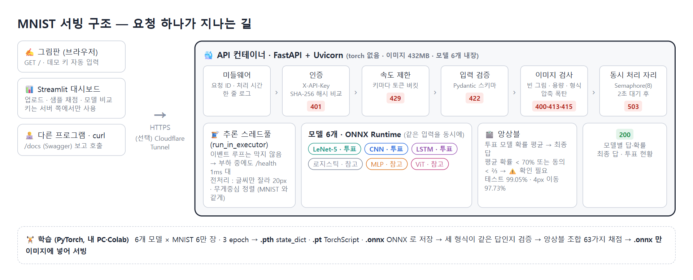
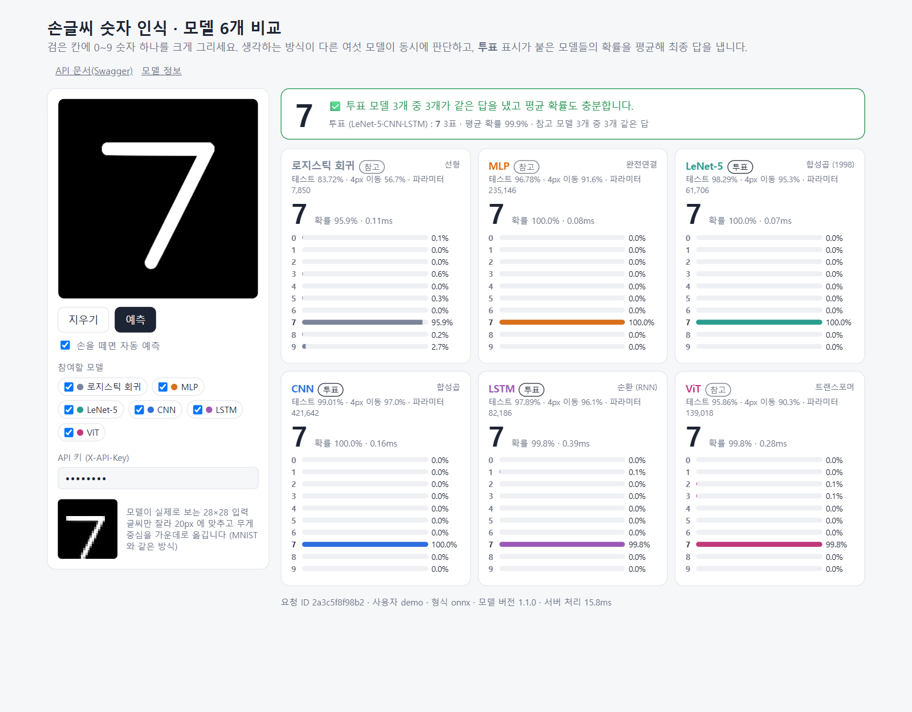
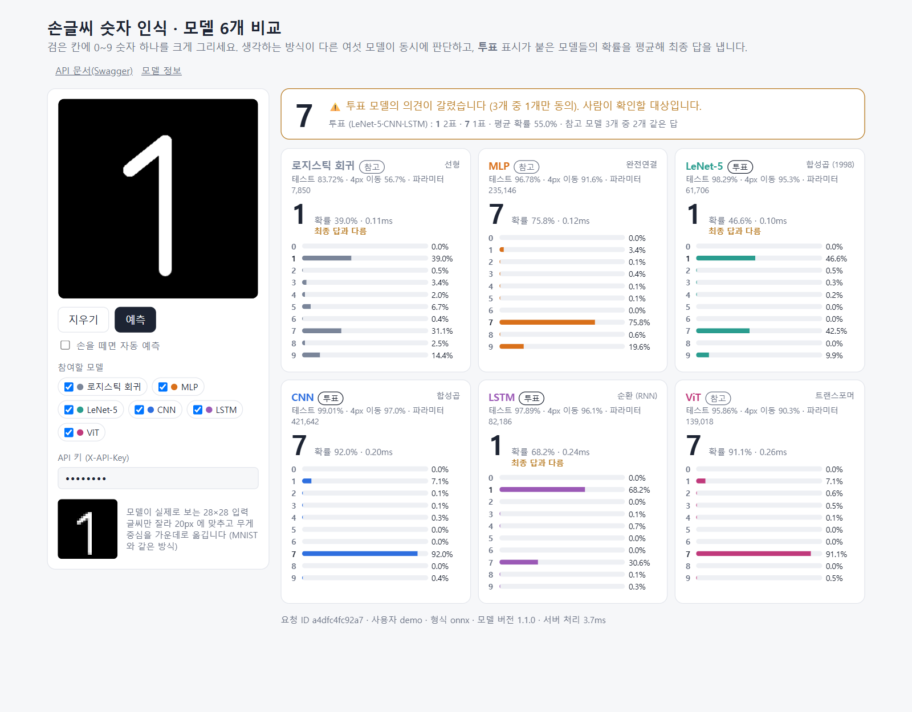
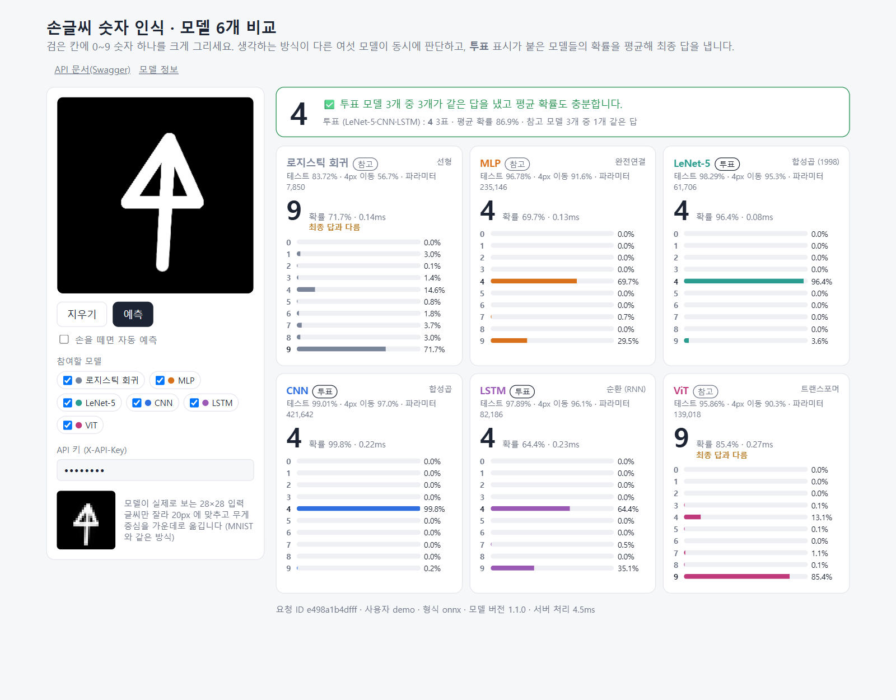
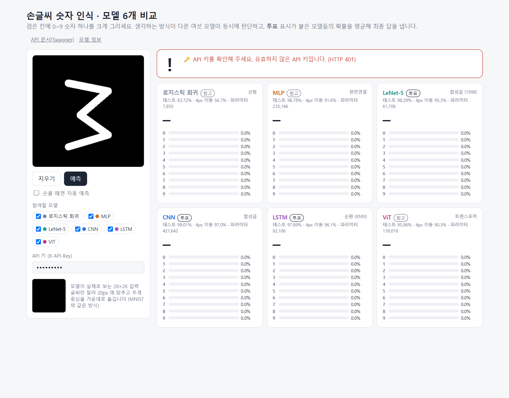
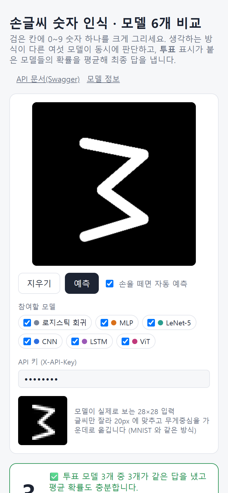
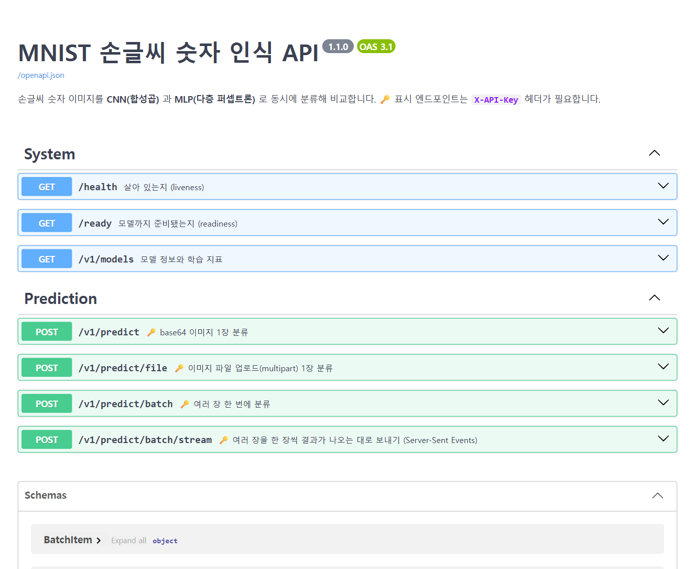
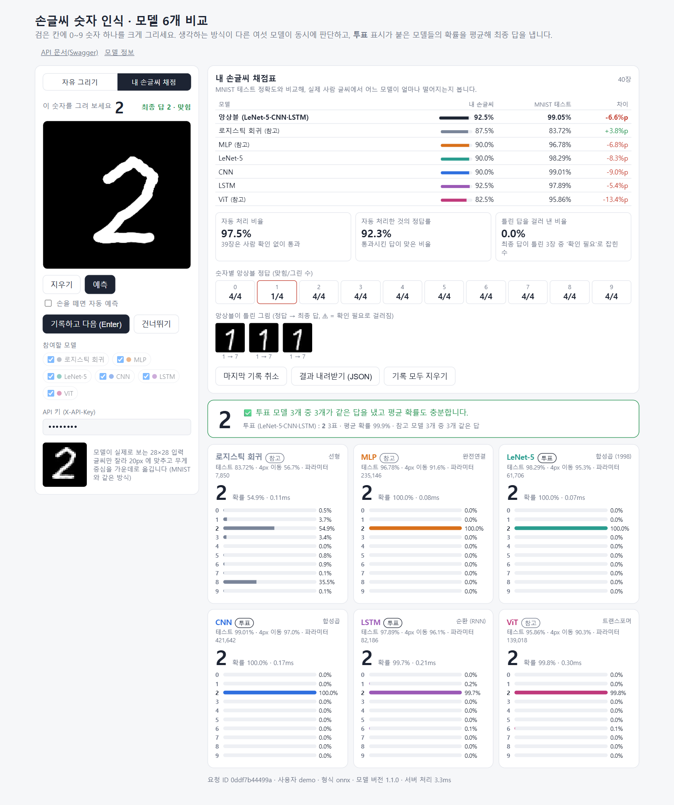
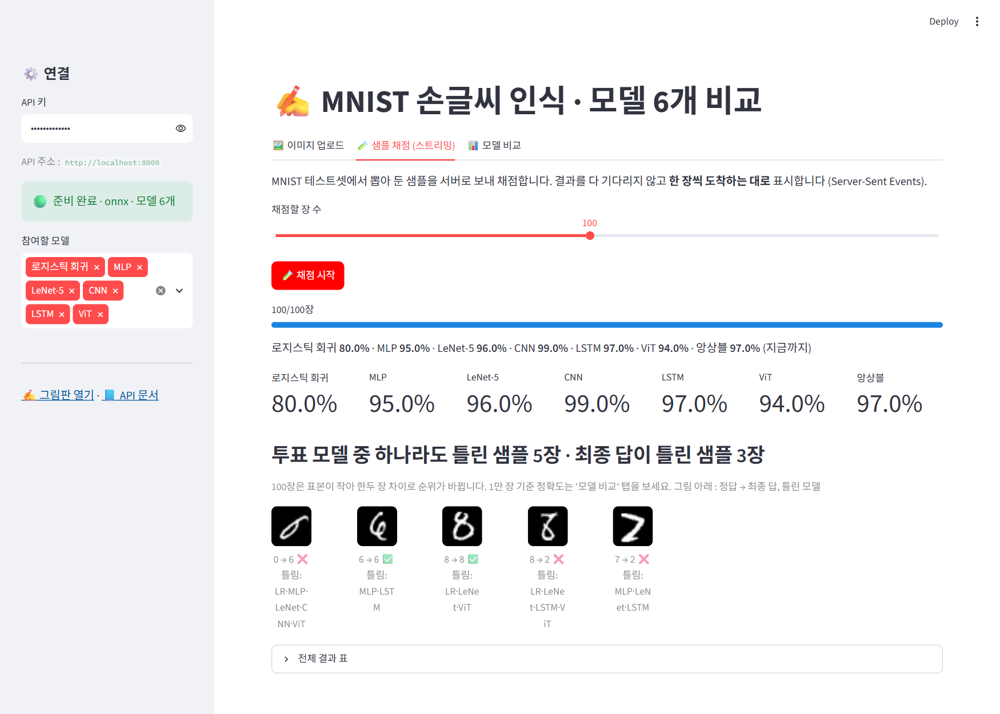
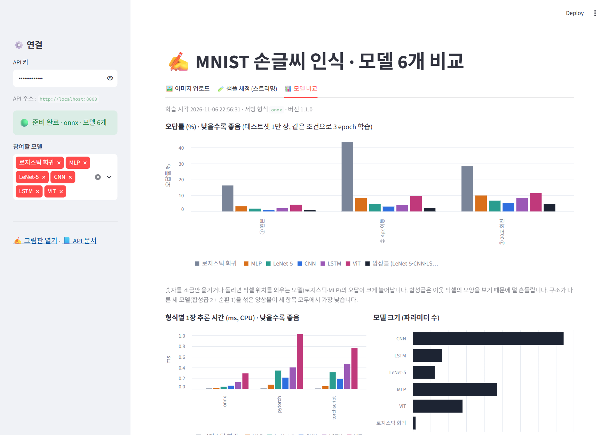

# 상세 문서 — MNIST 서빙 (모델 6개 비교 + 앙상블)

[← 요약(README.md)](README.md) · [구동 가이드(RUN_GUIDE.md)](RUN_GUIDE.md)

## 목차
1. [과정에서 배운 개념이 들어간 자리](#1-과정에서-배운-개념이-들어간-자리)
2. [모델 여섯 개](#2-모델-여섯-개)
3. [요청 하나가 지나는 길과 상태 코드](#3-요청-하나가-지나는-길과-상태-코드)
4. [설계 결정과 근거](#4-설계-결정과-근거)
5. [실험 결과](#5-실험-결과)
6. [화면](#6-화면)
7. [테스트](#7-테스트)
8. [트러블슈팅 기록](#8-트러블슈팅-기록)
9. [한계와 운영 보완점](#9-한계와-운영-보완점)
10. [회고 (KPT)](#10-회고-kpt)

**실행 환경** : Windows 11 노트북 (Intel CPU, 16스레드, GPU 없음) · Python 3.12.10 · torch 2.14.1+cpu · onnxruntime 1.31.1 · FastAPI 0.141.1 · Streamlit 1.66.1 · Docker 29.9 (WSL2)

---

## 1. 과정에서 배운 개념이 들어간 자리

| 일차·주제 | 배운 것 | 이 프로젝트의 자리 |
|---|---|---|
| 딥러닝 기초 | 선형 모델, MLP | `training/models.py` 의 `LogisticRegression`, `MLPClassifier` |
| CNN | 합성곱·풀링 | `LeNet5`, `CNNClassifier` (REST API 노트의 `SimpleClassifier` 와 같은 구조) |
| NLP · RNN | 문장을 단어 순서대로 읽는 순환 신경망 | `LSTMClassifier` : 28줄 = 단어 28개 |
| Transformer · BERT | 셀프 어텐션, [CLS] 토큰, 위치 임베딩 | `TinyViT` : 어텐션 `softmax(QKᵀ/√d)·V` 를 직접 구현 |
| REST API · 직렬화 | state_dict · TorchScript · ONNX 저장, 같은 출력 확인 | `training/train.py` 가 모델마다 세 형식으로 저장하고 출력 차이를 검사합니다. `app/inference.py` 는 `MODEL_BACKEND` 로 형식을 고릅니다 |
| REST API · 규격 | 자원 중심 경로, 버전, 상태 코드 | `/v1/...` 경로, 실패 응답을 한 가지 모양으로 통일 : `{"error": {"code", "message"}, "request_id"}` |
| FastAPI 기초 | 경로, Pydantic 검증, 자동 문서 | `app/schemas.py` (어기면 422), `/docs` |
| 비동기 처리 | `run_in_executor`, 동시 통과 제한, 스트리밍, 취소, 로깅, 미들웨어, 에러 핸들러, lifespan | 아래 4.6·4.7 참고 |
| 인증과 화면 | API 키, 해시 저장, `UploadFile`, 안전한 이미지 처리, Streamlit, AppTest | `app/auth.py` (SHA-256 + `compare_digest`), `/v1/predict/file`, `app/preprocess.py` (용량·형식·압축 폭탄), `frontend/streamlit_app.py` |
| 컨테이너 | 레이어 캐시, 이미지 크기, compose, 헬스체크 | `Dockerfile` (torch 없는 432MB 이미지, non-root 사용자, HEALTHCHECK), `compose.yaml` (`service_healthy` 로 순서 보장) |
| 게이트웨이 | 토큰 버킷 레이트 리밋, 준비 상태 확인, 요청 ID | `app/rate_limit.py` (키마다 버킷, 429 + `Retry-After`), `/health` 와 `/ready` 분리, `X-Request-ID` |
| 서빙 프로젝트 | 설정은 전부 환경 변수, 채점기, 부하 테스트 | `app/config.py` · `.env.example`, `tests/` 34개, `scripts/load_test.py` |
| 로컬 GPU 배포 | 버전 고정, 결과 보관, Colab 실행 | `requirements*.txt` 버전 고정, `models/metrics.json` 에 환경 기록, `colab_quickstart.ipynb` |

**비동기 처리 개념의 자리**
- `app/main.py` : 스레드풀과 `Semaphore` (자리가 없으면 503)
- `/v1/predict/batch/stream` : SSE 스트리밍, 연결이 끊기면 중단(취소)
- `app/middleware.py`, `app/errors.py` : 미들웨어와 에러 핸들러
- `lifespan` : 서버가 켜질 때 모델을 1회 로드

---

## 2. 모델 여섯 개

입력은 모두 `(N, 1, 28, 28)`, 출력은 모두 `(N, 10)` 입니다. 그래서 서버는 모델 종류를 몰라도 똑같이 다룹니다. 모델 이름·계열·화면 색·투표 여부는 `app/model_catalog.py` 한 곳에만 적었습니다. 학습 스크립트, 서버, 그림판, 대시보드가 모두 이 파일을 읽습니다.

| 모델 | 구조 | 파라미터 | 핵심 아이디어 |
|---|---|---:|---|
| 로지스틱 회귀 | 784 → 10 | 7,850 | 숫자마다 "어느 픽셀이 밝으면 이 숫자" 라는 가중치 한 장. 다른 모델이 이걸 얼마나 넘는지 보는 **기준선** |
| MLP | 784 → 256 → 128 → 10 | 235,146 | 은닉층이 조합을 배웁니다. 그래도 픽셀 **위치**를 하나하나 따로 봅니다 |
| LeNet-5 | 합성곱 5×5 (6·16개) → 120 → 84 → 10 | 61,706 | 1998년 우편번호 인식 모델. 활성화만 ReLU, 풀링만 최대 풀링으로 바꿨습니다 |
| CNN | 합성곱 3×3 (32·64개) → 128 → 10 | 421,642 | REST API 노트와 같은 구조 |
| LSTM | 28줄을 순서대로 읽음 (은닉 128) → 마지막 상태 → 10 | 82,186 | 한 줄(28픽셀) = 단어 하나. NLP 의 RNN 과 같은 구조이고, 입력만 단어 벡터 대신 픽셀 한 줄입니다 |
| ViT | 7×7 조각 16개 + [CLS] → 트랜스포머 블록 4개 (차원 64, 헤드 4) → 10 | 139,018 | 조각 = 토큰. BERT 처럼 [CLS] 자리 출력으로 분류. 어텐션은 수식 그대로 직접 구현 |

**ViT 의 어텐션 (`training/models.py`)**
```python
q, k, v = self.qkv(x).reshape(n, t, 3, self.heads, self.head_dim).permute(2, 0, 3, 1, 4)
attn = (q @ k.transpose(-2, -1)) / math.sqrt(self.head_dim)     # Q·Kᵀ / √d
attn = self.drop(attn.softmax(dim=-1))                           # softmax
out = (attn @ v).transpose(1, 2).reshape(n, t, d)               # · V
```
처음에는 PyTorch 의 `nn.TransformerEncoder` 를 썼습니다. 그런데 TorchScript 변환이 실패해서 직접 구현으로 바꿨습니다 (8.5 참고).

---

## 3. 요청 하나가 지나는 길과 상태 코드



검사 순서는 **싼 것부터** 입니다. 비싼 추론에 닿기 전에 가능한 한 일찍 거절합니다.

| 순서 | 단계 | 실패하면 | 응답 `error.code` 예 |
|---|---|---|---|
| 1 | 미들웨어 : 요청 ID, 처리 시간, 로그 한 줄 | — | — |
| 2 | 인증 : `X-API-Key` 의 SHA-256 을 저장된 해시와 비교 | **401** | `missing_api_key`, `invalid_api_key` |
| 3 | 속도 제한 : 키마다 토큰 버킷 | **429** + `Retry-After` | `rate_limited` |
| 4 | 입력 검증 : Pydantic 스키마 (없는 모델 이름 포함) | **422** (필드별 메시지) | `validation_error` |
| 5 | 이미지 검사 : base64 · 빈 그림 · 용량 · 형식 · 픽셀 수 | **400 · 413 · 415** | `invalid_base64`, `blank_image`, `too_large`, `too_many_pixels`, `not_an_image` |
| 6 | 동시 처리 자리 : `Semaphore(8)`, 최대 2초 대기 | **503** + `Retry-After` | `server_busy` |
| 7 | 스레드풀에서 전처리 → 모델 6개 추론 → 앙상블 | **500** (상세는 로그에만) | `internal_error` |
| — | 모델 로드 전 / 서버에서 끈 모델을 요청 | **503** / **400** | `model_loading` / `model_not_enabled` |

> 2→3→4 순서는 테스트를 돌리다가 확인했습니다 (8.1).

**정상 응답 (200) 예** — 위 첫 화면의 '깃발 달린 1'
```json
{
  "results": {
    "logreg": {"pred": 1, "confidence": 0.390, "...": "..."},
    "mlp":    {"pred": 7, "confidence": 0.758},
    "lenet":  {"pred": 1, "confidence": 0.466},
    "cnn":    {"pred": 7, "confidence": 0.920},
    "lstm":   {"pred": 1, "confidence": 0.682},
    "vit":    {"pred": 7, "confidence": 0.911}
  },
  "ensemble": {"pred": 7, "confidence": 0.550, "votes": {"1": 2, "7": 1}, "agreement": 0.3333,
               "members": ["lenet", "cnn", "lstm"]},
  "agree": false, "needs_review": true, "backend": "onnx", "model_version": "1.1.0"
}
```

---

## 4. 설계 결정과 근거

### 4.1 서빙은 ONNX, 학습은 PyTorch
- **출력이 같습니다.** 여섯 모델 모두 세 형식의 출력 차이가 최대 0.0000054 이고, 64장의 예측이 모두 같았습니다.
- **빠릅니다.** ONNX Runtime 이 1장 추론에서 3~8배 빠릅니다 (5.5).
- **결정적인 이유는 서빙 이미지에서 torch 를 뺄 수 있다는 점입니다.**
  - torch 를 넣은 같은 서버 이미지는 1.69GB 였습니다 (모델 2개 시점에 측정).
  - ONNX 만 쓰면 모델 6개를 넣어도 **432MB** 입니다.
- `MODEL_BACKEND` 를 바꾸면 다른 두 형식으로도 서빙할 수 있게 남겨 두었습니다. 형식 비교 실습과 테스트에 씁니다.

### 4.2 "MNIST 처럼 보이게" 하는 전처리
MNIST 는 숫자를 **20×20 안에 맞춘 뒤, 무게중심이 28×28 의 가운데에 오게** 놓은 데이터입니다. 그림판의 280×280 그림을 그대로 줄이면 숫자가 작거나 한쪽에 치우칩니다. 그래서 서버가 다음 순서로 바꿉니다.
1. 흑백으로 바꾸고, 흰 배경이면 반전합니다.
2. 옅은 잡티를 지웁니다.
3. 글씨 부분만 잘라 냅니다.
4. 긴 변을 20px 에 맞춥니다.
5. 무게중심이 (14, 14) 에 오게 놓되, 28×28 밖으로 나가지 않게 범위를 제한합니다.

모델이 실제로 본 28×28 이미지를 응답(`preview`)과 화면에 함께 보여 줍니다.

### 4.3 앙상블 : 누구를 투표시킬 것인가
처음에는 여섯 모델의 확률을 모두 평균했습니다. 그런데 결과가 CNN 혼자보다 낮았습니다 (98.87% < 99.01%). 그래서 `training/ensemble_eval.py` 로 **가능한 조합 63가지를 모두 채점**했습니다.

| 순위 | 조합 | 원본 | 4px 이동 | 20도 회전 |
|---:|---|---:|---:|---:|
| 1 | **LeNet-5 + CNN + LSTM** | **99.05%** | **97.73%** | **95.54%** |
| 2 | LeNet-5 + CNN | 99.01% | 97.06% | 94.91% |
| 3 | CNN 혼자 | 99.01% | 96.97% | 94.64% |
| 4 | LeNet-5 + CNN + LSTM + ViT | 98.99% | 97.52% | 95.02% |
| 6 | CNN + LSTM | 98.95% | 97.71% | 95.26% |
| — | 6개 전부 | 98.87% | 96.88% | 94.67% |

- 상위 조합은 **합성곱 + 순환**처럼 **보는 방식이 다른** 모델을 섞었습니다. 모델들이 서로 다른 곳에서 틀려야 평균이 실수를 덮어 줍니다.
- 원본 정확도 차이는 작습니다 (CNN 보다 4장 더 맞힘). 진짜 이득은 **견고성**입니다. 4px 이동에서 76장, 20도 회전에서 90장을 더 맞혔습니다.
- 그래서 **LeNet-5 · CNN · LSTM 을 투표 모델**로 정했습니다. 나머지 셋은 화면에 '참고'로 보여 줍니다.
- 투표 모델은 `ENSEMBLE_MODELS` 환경 변수로 바꿀 수 있습니다.
- ⚠️ **한계** : 테스트셋 점수를 보고 조합을 골랐으므로 이 점수는 약간 낙관적입니다. 제대로 하려면 학습셋에서 검증셋을 떼어 내 그것으로 고르고, 테스트셋은 마지막 확인에만 써야 합니다 (10장 Try).

**다수결이 아니라 확률 평균(soft voting)** 입니다. 첫 화면의 '깃발 달린 1' 이 좋은 예입니다.
- 투표 모델 셋 중 LeNet-5(47%)·LSTM(68%) 은 1, CNN(92%) 은 7 이었습니다.
- 다수결이면 1 이지만, 확률을 평균하면 7(55%) 이 1(41%) 보다 큽니다.
- 대신 동의가 ⅓ 뿐이라 **확인 필요** 로 넘어갑니다. 사람이 봐도 1 과 7 사이에서 애매한 글씨입니다.

### 4.4 "확인 필요" 규칙
`needs_review = (투표 모델 확률 평균 < 0.7) or (최종 답에 동의한 투표 모델 비율 < 0.66)`

| 상황 | 결과 |
|---|---|
| 셋 다 같은 답, 평균 확률 높음 | ✅ 자동 처리 |
| 셋 중 둘이 같은 답 (⅔), 평균 확률 높음 | ✅ 자동 처리 |
| 셋 중 하나만 최종 답과 같음 (⅓) | ⚠️ 의견이 갈림 |
| 셋 다 같은 답인데 모두 망설임 (평균 70% 미만) | ⚠️ 확신 부족 |

- 참고 모델은 판정에 넣지 않습니다. 그래서 '윗부분이 닫힌 4' 처럼 로지스틱 회귀·ViT 가 9 라고 해도, 투표 모델 셋이 4 로 확신하면 자동 처리됩니다 (6장 화면).
- 기준값 0.7 · 0.66 은 환경 변수(`REVIEW_THRESHOLD`, `MIN_AGREEMENT`)입니다.

### 4.5 데모 키를 화면에 내려 주는 문제
- 외부 사람이 그림판을 바로 써 보려면 키를 몰라도 돼야 합니다. 그런데 브라우저에서 API 를 부르면 키가 브라우저에 보일 수밖에 없습니다.
- 그래서 키를 둘로 나눴습니다.
  - **관리자 키** : Streamlit 처럼 서버 쪽에서만 씁니다.
  - **데모 키** : `/ui-config` 로 화면에 채워 주고, 키마다 속도 제한을 겁니다.
- 공개하고 싶지 않으면 `PUBLIC_DEMO_KEY=` 로 비우면 됩니다.

### 4.6 속도 제한을 서버 안에
- 원래는 서버 앞 게이트웨이가 할 일입니다. 하지만 컨테이너 하나로도 터널·Spaces 로 공개할 수 있어야 해서 서버 안에 넣었습니다.
- 한계 : 버킷이 프로세스마다 따로 생깁니다. 워커나 서버가 여럿이면 Redis 같은 공용 저장소로 옮겨야 합니다.

### 4.7 동시성 : 스레드 2개, 자리 8개, 대기 2초
- 추론, base64 해석, 이미지 디코딩, 전처리를 모두 스레드풀로 넘깁니다. 이벤트 루프에는 가벼운 일만 남깁니다.
- ONNX 세션은 모델 하나당 1스레드입니다. 동시성은 스레드풀이 맡습니다.
- 동시에 처리하는 요청은 `Semaphore(8)` 로 막습니다. 넘치면 2초 기다렸다가 503 으로 빨리 거절합니다.

### 4.8 스트리밍(SSE)과 취소
- `/v1/predict/batch/stream` 은 결과를 다 모으지 않고 **한 장씩** `event: item` 으로 보냅니다. 대시보드는 진행 막대와 '지금까지의 모델별 정확도'를 실시간으로 갱신합니다.
- 클라이언트가 연결을 끊으면 남은 추론을 멈춥니다.

### 4.9 모델 파일을 git 에 포함
- 6개 모델 × 3형식 = 18개 파일, 합계 **12MB** 라 저장소에 넣었습니다.
- 그래서 `git clone` 다음 `docker compose up` 만 하면 **학습 없이** 바로 서빙됩니다.
- Docker 이미지에는 `.onnx` 6개만 들어갑니다.

### 4.10 모델 추가가 쉬운 구조
새 모델은 세 단계로 붙습니다. 그림판과 대시보드는 `/v1/models` 를 읽어 카드와 차트를 자동으로 그립니다.
1. `training/models.py` 에 클래스를 만듭니다.
2. `app/model_catalog.py` 에 한 줄을 추가합니다.
3. `python -m training.train --models <키>` 를 실행합니다.

### 4.11 대시보드의 내장 모드 (Streamlit Community Cloud 용)
Streamlit Community Cloud(`xxx.streamlit.app`)는 Streamlit 앱 하나만 실행할 수 있습니다. 그래서 대시보드가 API 주소를 정하는 순서를 둡니다.
1. `API_BASE_URL` 환경 변수
2. `localhost:8000` 에 떠 있는 서버
3. 둘 다 없으면 **내장 모드**
   - `uvicorn.Server` 를 데몬 스레드로 띄웁니다. 주소는 `127.0.0.1` 의 빈 포트입니다.
   - `st.cache_resource` 로 감싸서, 화면이 다시 실행돼도 서버는 한 번만 뜹니다.

화면이 API 함수를 직접 부르지 않고 HTTP 로 부르는 이유가 있습니다. 그래야 **따로 띄웠을 때와 같은 경로**를 지납니다(인증·속도 제한·검증·동시 처리 자리). 내장 API 는 컨테이너 밖에서 닿지 않으므로 외부에 공개되는 것은 화면뿐입니다. Cloud 용 패키지 목록은 `frontend/requirements.txt` 입니다.

### 4.12 내 손글씨 채점 모드
MNIST 테스트 점수는 MNIST 글씨에 대한 점수입니다. 서비스에서 만나는 건 사람이 마우스·손가락으로 그린 글씨입니다. 그 차이를 재려고 그림판에 채점 모드를 넣었습니다 (`/#score` 로 바로 열림).

| 결정 | 이유 |
|---|---|
| 화면이 숫자를 정해 줌 (0~9 를 섞어 10장마다 한 번씩) | 정답을 따로 입력할 필요가 없고, 숫자별 개수가 고르게 모입니다 |
| 채점 중에는 6개 모델을 모두 사용 (모델 선택 잠금) | 모델별 정확도를 같은 그림들로 비교해야 공정합니다 |
| 기록은 `localStorage` 에만, 서버에는 저장 안 함 | 사용자 그림을 서버에 모으려면 동의·보관 정책이 필요합니다. 기능 확인 단계에서는 브라우저에 두는 게 맞다고 봤습니다 |
| 다시 그리기 시작하면 '기록' 버튼을 끔 | 이전 그림의 결과가 새 그림의 정답으로 잘못 기록되는 것을 막습니다 |
| 30장 미만이면 경고 | 10장이면 한 장에 10%p 씩 움직여 모델 비교가 의미 없습니다 |
| 내려받기는 모델이 실제로 본 28×28 픽셀 | 서버 전처리를 한 번 더 거쳐도 같은 입력이 됩니다. 다시 채점하면 기록 당시와 같은 답이 나오는 것을 확인했습니다 |

화면이 보여 주는 것
- 모델별 '내 손글씨' 정확도와 MNIST 테스트 정확도의 차이
- 서비스 지표 세 가지
  - **자동 처리 비율** : 사람 확인 없이 통과한 비율
  - **자동 처리한 것의 정답률** : 통과시킨 답이 맞은 비율
  - **틀린 답을 걸러 낸 비율** : 최종 답이 틀린 그림 중 '확인 필요'로 잡힌 비율
- 숫자별 앙상블 정답 수, 앙상블이 틀린 그림 모음

`scripts/score_my_digits.py` 는 내려받은 파일을 지금 서버로 다시 채점합니다. 모델을 바꾸기 전후를 같은 손글씨로 비교하는 회귀 테스트입니다. `--npz` 를 주면 학습용 배열로 저장합니다.

---

## 5. 실험 결과

### 5.1 학습 (CPU, 3 epoch, 배치 128, Adam 1e-3, 약한 회전·이동 증강, 모두 같은 조건)

| 모델 | epoch 1 | epoch 2 | epoch 3 | 학습 시간 |
|---|---:|---:|---:|---:|
| 로지스틱 회귀 | 84.42% | 83.85% | 83.72% | 21초 |
| MLP | 95.41% | 96.65% | 96.78% | 25초 |
| LeNet-5 | 97.12% | 97.74% | 98.29% | 103초 |
| CNN | 98.11% | 98.74% | 99.01% | 64초 |
| LSTM | 96.06% | 97.44% | 97.89% | 42초 |
| ViT | 88.34% | 95.18% | 95.86% | 120초 |

ViT 는 epoch 마다 크게 오르는 중이었습니다. 학습을 더 하면 더 올라갈 여지가 큽니다. 같은 3 epoch 에서는 합성곱보다 불리했습니다.

### 5.2 견고성 : 숫자를 조금만 옮기거나 돌리면 (오답률, 낮을수록 좋음)

| 모델 | 원본 | 4px 이동 | 20도 회전 |
|---|---:|---:|---:|
| 로지스틱 회귀 | 16.28% | 43.31% | 28.32% |
| MLP | 3.22% | 8.40% | 10.00% |
| LeNet-5 | 1.71% | 4.68% | 6.73% |
| CNN | 0.99% | 3.03% | 5.36% |
| LSTM | 2.11% | 3.91% | 8.50% |
| ViT | 4.14% | 9.68% | 11.56% |
| **앙상블 (LeNet-5 + CNN + LSTM)** | **0.95%** | **2.27%** | **4.46%** |

- **위치를 외우는 모델(로지스틱·MLP)은 이동에 약합니다.**
- **합성곱(LeNet-5·CNN)은 이동과 회전에 고르게 강합니다.**
- **LSTM 은 이동에 강하고 회전에 약합니다.** 줄 단위로 읽어서, 위아래로 밀리는 것은 '문장이 늦게 시작하는 것'과 비슷하기 때문입니다. 회전하면 각 줄의 모양 자체가 바뀝니다.
- **ViT 는 조각(7×7)의 경계가 고정돼 있습니다.** 숫자가 밀리면 조각에 담기는 내용이 통째로 바뀌어 약했습니다.

### 5.3 데이터 증강이 오히려 해가 된 모델 : 로지스틱 회귀
로지스틱 회귀가 83.72% 로 이 모델의 보통 성적(약 92%)보다 낮았습니다. 그래서 같은 설정에서 **증강만 끄고** 다시 학습해 봤습니다.

| 로지스틱 회귀 | 원본 | 4px 이동 | 20도 회전 |
|---|---:|---:|---:|
| 증강 없이 | **92.07%** | 37.44% | **76.22%** |
| 증강 (다른 모델과 같은 조건) | 83.72% | **56.69%** | 71.68% |

- 은닉층이 없는 선형 모델은 "숫자 하나당 템플릿 한 장"밖에 못 가집니다.
- 그래서 여러 위치·기울기를 한 장에 다 담으려다 **원본 성적까지 떨어졌습니다**.
- 증강이 없으면 원본은 잘 맞히지만 4px 만 밀어도 37% 로 무너집니다.
- **증강은 모델이 그것을 담을 '용량'이 있을 때 도움이 됩니다.** 표에는 공정한 비교를 위해 같은 조건(증강)의 결과를 썼습니다.

### 5.4 서빙 샘플 채점 (대시보드, 서버 전처리를 거친 200장)
CNN 99.0% · LSTM 97.0% · LeNet-5 96.5% · ViT 96.0% · MLP 95.0% · 로지스틱 84.5% · 앙상블 97.5%

- 이 200장에서는 앙상블이 CNN 혼자보다 낮았습니다. 처음에는 서버 전처리 때문인지(학습 때와 서빙 때 입력이 달라지는 문제) 의심했습니다.
- 같은 200장을 전처리 없이 넣어도 결과가 같았습니다. MNIST 는 이미 20px 에 맞춰져 있습니다.
- 결론은 **작은 표본의 흔들림**입니다. 1만 장 기준으로는 앙상블이 원본·이동·회전 모두 1위입니다 (8.7).

### 5.5 직렬화 형식 비교 (1장 추론, CPU, 중앙값)

| 모델 | PyTorch | TorchScript | **ONNX** | ONNX 가 빠른 배수 | ONNX 파일 |
|---|---:|---:|---:|---:|---:|
| 로지스틱 회귀 | 0.008ms | 0.007ms | 0.008ms | 1.0배 | 0.03MB |
| MLP | 0.077ms | 0.049ms | 0.017ms | 4.5배 | 0.95MB |
| LeNet-5 | 0.344ms | 0.312ms | 0.041ms | 8.4배 | 0.27MB |
| CNN | 0.211ms | 0.182ms | 0.059ms | 3.6배 | 1.70MB |
| LSTM | 0.403ms | 0.468ms | 0.127ms | 3.2배 | 0.36MB |
| ViT | 1.027ms | 0.762ms | 0.290ms | 3.5배 | 0.75MB |

- 원본 대비 최대 출력 차이는 TorchScript 0, ONNX 0.0000019 ~ 0.0000054 입니다.
- 로지스틱 회귀는 계산이 너무 작아 형식 차이가 드러나지 않습니다.

| 형식 | 불러올 때 필요한 것 |
|---|---|
| state_dict | torch + **모델 클래스 코드** |
| TorchScript | torch |
| ONNX | **onnxruntime 만** |

### 5.6 Docker 이미지

| 이미지 | 크기 | 모델 로드 |
|---|---:|---:|
| API · ONNX Runtime · 모델 6개 (채택) | **432MB** | 0.08초 |
| API · ONNX Runtime · 모델 2개 (첫 버전) | 430MB | 0.06초 |
| API · PyTorch CPU (비교용, 모델 2개) | 1.69GB | 0.93초 |
| UI · Streamlit | 799MB | — |

### 5.7 부하 테스트
- 같은 노트북에서 부하 생성기(파이썬 1프로세스)와 서버를 함께 돌렸습니다.
- 그림판 크기 PNG 3,000건을 보냈습니다. 서버는 워커 1개이고 속도 제한은 껐습니다.
- `/health` 는 **별도 프로세스**에서 쟀습니다 (8.2).

| 동시 요청 | 모델 6개 처리량 | 지연 p50 | 지연 p95 | 상태 코드 | 부하 중 `/health` p50 | (참고) 모델 2개 지연 p50 |
|---:|---:|---:|---:|---|---:|---:|
| 1 | 270 req/s | 3.5ms | 4.6ms | 200 × 3000 | 1.2ms | 2.9ms |
| 16 | 468 req/s | 27.6ms | 92.9ms | 200 × 3000 | 1.7ms | 17.2ms |
| 64 | 267 req/s | 136.3ms | 794.1ms | 200 × 3000 | 1.2ms | 140.0ms |

- 모델을 2개에서 6개로 늘려도 1건씩 보낼 때 응답은 **0.6ms** 만 늘었습니다. ONNX 추론 자체는 6개를 합쳐도 0.6ms 정도입니다.
- 남는 시간은 대부분 HTTP·base64·PNG 디코딩·전처리입니다.
- 워커를 4개로 늘려도 처리량이 그대로였습니다 (모델 2개 시점에 측정). 이 PC 에서는 **부하 생성기가 서버보다 먼저 한계**에 닿았습니다. 서버의 진짜 상한은 재지 못했습니다.

### 5.8 속도 제한 확인
기본 설정(버스트 20)으로 100건을 몰아 보냈습니다. 200 이 20건, 429 가 80건이었습니다.

---

### 5.9 내 손글씨 채점 (기능 확인용 자동 입력 40장)
마우스 선을 자동으로 그어 기능을 확인했습니다. 흔히 헷갈리는 모양을 섞었습니다(깃발 1, 윗부분이 닫힌 4, 가로줄 7, 고리 있는 2). **사람 손글씨 결과가 아닙니다.**

| | 앙상블 | LeNet-5 | CNN | LSTM | MLP | 로지스틱 | ViT |
|---|---:|---:|---:|---:|---:|---:|---:|
| 자동 입력 40장 | 92.5% | 90.0% | 90.0% | 92.5% | 90.0% | 87.5% | 82.5% |
| MNIST 테스트 | 99.05% | 98.29% | 99.01% | 97.89% | 96.78% | 83.72% | 95.86% |

- 틀린 3장은 모두 깃발 달린 1 이었습니다. 투표 모델 셋이 모두 **확신을 갖고 7** 이라고 해서 '확인 필요'에 걸리지 않았습니다 (걸러 낸 비율 0%).
- '확인 필요' 규칙은 의견이 갈리거나 망설이는 경우만 잡습니다. **확신에 찬 오답**은 잡지 못합니다. 같은 1 이라도 4.3 의 예처럼 의견이 갈리면 걸러집니다. 모양에 따라 결과가 달라진다는 뜻입니다.
- 로지스틱 회귀만 MNIST 보다 높게 나왔지만, 40장으로는 의미 있는 차이가 아닙니다.

## 6. 화면

| 그림판 : 모두 일치 | 그림판 : 확인 필요 (의견이 갈림) |
|---|---|
|  |  |
| 여섯 모델 모두 7 → ✅ | 깃발 달린 1. 투표 1·1·7 이지만 확률 평균은 7(55%). 동의 ⅓ → ⚠️ |

| 그림판 : 참고 모델만 다름 | 그림판 : 인증 실패 |
|---|---|
|  |  |
| 윗부분이 닫힌 4. 로지스틱·ViT 는 9 지만 투표 모델 셋이 4 (평균 86.9%) → ✅ | 틀린 키 → 401 안내 (화면은 멈추지 않음) |

| 그림판 : 휴대폰 | Swagger (자동 생성 API 문서) |
|---|---|
|  |  |

| 그림판 : 내 손글씨 채점 | |
|---|---|
|  | 목표 숫자를 그리고 기록하면 모델별 정확도(MNIST 대비), 자동 처리·정답·걸러 낸 비율, 숫자별 정답, 틀린 그림이 쌓입니다. 캡처는 자동 입력 40장 |

| Streamlit : 샘플 채점 (SSE) | Streamlit : 모델 비교 |
|---|---|
|  |  |
| 한 장씩 받아 모델별 실시간 정확도, 틀린 샘플 모아 보기 | 오답률 · 형식별 추론 시간 · 파라미터 · 앙상블 조합 탐색 |

---

## 7. 테스트

`python -m pytest` → **34 passed** (약 2초). torch 가 없는 환경(CI·서빙 이미지)에서는 형식 비교 6개를 건너뛰어 28개입니다. 서버를 따로 띄우지 않고 `TestClient` 로 lifespan 까지 실행합니다.

| 분류 | 테스트 |
|---|---|
| 상태 | `/health`·`/ready` (모델 6개), `/v1/models` 공개 (계열·앙상블 지표 포함), 그림판·`/ui-config` |
| 200 | 그림판 위치를 바꿔 붙인 숫자 20장 (CNN·앙상블 각각 18장 이상), 요청 ID 되돌려 주기, 모델 하나만 선택, **모델 일부 선택 (중복 제거·순서 유지)**, 흰 배경 사진 반전, 파일 업로드 |
| 앙상블 | **확률 평균 규칙** (다수결과 다른 경우 포함), **의견이 갈린 실제 샘플 → 확인 필요**, 일괄 응답의 앙상블 = 투표 모델 확률 평균 |
| 401 | 키 없음, 틀린 키 |
| 422 | 필드 누락, 없는 모델 이름, 일괄 33장, labels 개수 불일치 |
| 400·413·415 | 잘못된 base64, 빈 그림, 이미지가 아닌 파일, 2MB 초과, 압축 폭탄(3000×3000) |
| 일괄·스트리밍 | 잘못된 한 장이 섞여도 나머지 처리 + 모델별·앙상블 정확도, SSE 이벤트 순서 |
| 429 | 버스트 2 → `200, 200, 429` + `Retry-After` |
| 내 손글씨 | 그림판에 채점 모드가 있음, 내려받은 파일 읽기·정확도 계산, 다른 형식 파일 거부, 40장(32장 묶음 경계를 넘김)을 서버로 다시 채점 |
| 전처리 | 무게가 쏠린 글씨가 가장자리를 넘어가지 않음 |
| 형식 | **6개 모델 각각** 세 형식의 출력 차이 < 1e-4, 예측 일치 |

그 밖에 직접 확인한 것
- Streamlit : AppTest 로 브라우저 없이 실행했습니다. 200장을 채점해 모델별 metric 7개와 오답 목록이 나왔습니다.
- Docker 스택 : 컨테이너 API 에 테스트 숫자 20장을 보내 앙상블 20/20, 대시보드 200 을 확인했습니다.

---

## 8. 트러블슈팅 기록

### 8.1 테스트 12개가 한꺼번에 429 로 실패
- **증상** : 뒤쪽 테스트가 422·400 대신 **429** 로 실패했습니다.
- **원인** : 모든 테스트가 같은 키를 써서 버킷(버스트 20)이 바닥났습니다.
- **같이 알게 된 것** : 잘못된 입력도 429 가 먼저 나왔습니다. FastAPI 는 **의존성(인증·속도 제한)을 본문 검증보다 먼저** 실행합니다.
- **해결** : 테스트에서만 버스트를 크게 주고, 429 는 전용 키와 작은 버킷으로 따로 확인합니다.

### 8.2 "부하 중 `/health` 가 100ms" — 측정기가 바빴다
- **증상** : `/health` 가 100ms 를 넘었습니다.
- **시도** : 전처리를 스레드로 옮겨 보고, 워커를 4개로 늘려 봤습니다. 둘 다 변화가 없었습니다.
- **원인** : `/health` 를 부하 생성 스크립트와 **같은 이벤트 루프 안에서** 재고 있었습니다. 별도 프로세스로 쟀더니 1ms 대였습니다.
- **해결** : `load_test.py` 가 `/health` 를 별도 프로세스에서 재도록 고쳤습니다.

### 8.3 무게중심 정렬과 `np.roll`
- 스크린샷에서 7 이 아래 끝에 붙어 보여 버그로 의심했습니다. 같은 입력으로 재현해 보니 정상이었습니다.
- 다만 무게가 극단적으로 쏠린 글씨는 `np.roll` 이 끝을 반대편으로 넘기는 것을 찾았습니다. 그래서 범위를 제한하는 방식으로 고치고 회귀 테스트를 남겼습니다.

### 8.4 여섯 개를 다 섞었더니 CNN 혼자보다 낮다
- 직관과 달랐습니다. 약한 모델(로지스틱 83.7%)의 틀린 확률이 평균을 끌어내렸습니다.
- 63가지 조합을 모두 채점해 투표 모델을 골랐습니다 (4.3). 조합 탐색은 스크립트로 남겨 다시 돌릴 수 있습니다.

### 8.5 ViT 만 TorchScript 변환이 실패
- `nn.TransformerEncoder` 는 상황에 따라 다른 계산 경로(fast path)를 탑니다. 그래서 `torch.jit.trace` 가 "실행할 때마다 그래프가 다르다"며 실패했습니다.
- 셀프 어텐션을 수식 그대로 직접 구현해 해결했습니다. ONNX 변환은 원래 구현으로도 됐습니다.
- 직접 구현한 덕분에 과정에서 배운 `softmax(QKᵀ/√d)·V` 가 코드에 그대로 드러납니다.

### 8.6 "정답이 0 인데 앙상블이 6" — 테스트의 가정이 틀렸다
- 테스트 하나가 "샘플 0번은 앙상블이 맞혀야 한다"고 가정했다가 실패했습니다.
- 들여다보니 샘플 0번은 6 처럼 기울어진 애매한 0 이었습니다. 모델들의 답이 1·1·6·6·0·8 로 갈렸습니다.
- 모델이 아니라 **테스트의 가정**이 틀린 것이라, 이 샘플은 오히려 **'의견이 갈리면 확인 필요로 표시되는가'** 를 확인하는 테스트로 바꿨습니다.

### 8.7 대시보드 200장에서는 앙상블이 CNN 보다 낮다
- 1만 장 기준으로는 앙상블이 1위인데, 200장 채점에서는 CNN 99.0% > 앙상블 97.5% 였습니다.
- 학습 때와 서빙 때 입력이 다른 문제(서버 전처리)를 의심했습니다. 같은 200장을 전처리 없이 넣어 비교했더니 결과가 같았습니다.
- 원인은 **표본이 작은 것**이었습니다. 대시보드에 "작은 표본은 한두 장 차이로 순위가 바뀐다"는 안내를 넣었습니다.

### 8.8 작은 것들
- Streamlit 차트 색이 모델과 반대로 나와서, 순서를 카탈로그 순서로 고정했습니다.
- 정확도 99% 와 97% 는 막대로 차이가 안 보여서, 오답률로 바꿔 그렸습니다.
- 숫자 뒤 조사("7 라고")가 어색해서, 조사가 필요 없는 문장으로 바꿨습니다.

---

## 9. 한계와 운영 보완점

| 지금은 | 실제 서비스라면 |
|---|---|
| 앙상블 조합을 테스트셋으로 골랐습니다 | 학습셋에서 검증셋을 떼어 그것으로 고르고, 테스트셋은 마지막에 한 번만 씁니다 |
| 모든 모델이 같은 3 epoch 입니다 (ViT 는 더 오를 여지가 있음) | 모델마다 검증셋 기준으로 조기 종료합니다 |
| API 키를 환경 변수에 둡니다 | 시크릿 저장소에 두고, 키마다 만료·회수합니다 |
| 속도 제한 버킷이 프로세스 메모리에 있습니다 | 워커·서버가 여럿이면 Redis 로 공유하거나 게이트웨이로 옮깁니다 |
| 확인 필요 기준 0.7 · 0.66 은 그려 본 몇 장으로 정했습니다 | 실제 손글씨를 모아 정밀도·재현율을 보고 다시 정합니다 |
| 서버 처리량 상한을 재지 못했습니다 | 부하 생성기를 다른 기계나 여러 프로세스(locust 등)로 돌립니다 |
| 내장 모드에서는 방문자 모두가 같은 키·같은 속도 제한을 나눠 씁니다 | 대시보드 서버가 방문자(세션)마다 한도를 따로 둡니다 |
| 터널 주소는 임시입니다 | 고정 도메인 + HTTPS 리버스 프록시, 또는 Spaces 를 씁니다 |
| 모델 교체 = 재배포입니다 | 버전별 경로나 게이트웨이 카나리 분할로 무중단 교체합니다 |

## 10. 회고 (KPT)

**Keep**
- 과정에서 배운 **모델 계열(선형·MLP·CNN·RNN·트랜스포머)을 한 문제에 모두** 적용해 같은 조건으로 비교했습니다.
- "섞으면 좋아지겠지"를 믿지 않고 **63가지 조합을 모두 채점**해 근거를 남겼습니다.
- 실패 경로와 앙상블 규칙을 **테스트 34개**로 고정했습니다.
- MNIST 점수에서 멈추지 않고, **실제로 그린 글씨로 다시 재는 도구**를 만들었습니다. 덕분에 '확인 필요' 규칙이 확신에 찬 오답은 못 잡는다는 것을 수치로 확인했습니다.

**Problem**
- 측정 도구가 병목인 줄 모르고 서버를 의심했습니다.
- 앙상블 조합을 테스트셋으로 골라 점수가 약간 낙관적입니다.
- 테스트를 쓸 때 "이 샘플은 맞혀야 한다"는 가정을 확인하지 않았습니다.

**Try**
- 검증셋을 따로 떼어 조합 선택과 조기 종료에 쓰겠습니다.
- ViT 를 더 오래 학습하고, 패치 크기를 바꿔 이동에 약한 원인을 확인하겠습니다.
- 사람이 그린 손글씨를 모아 검증셋으로 쓰고, 확신에 찬 오답을 잡는 규칙(입력이 MNIST 분포에서 벗어난 정도 등)을 실험하겠습니다.
- 모델 버전을 두 개 띄우고 게이트웨이에서 카나리로 바꿔 끼우는 것까지 해 보겠습니다.
