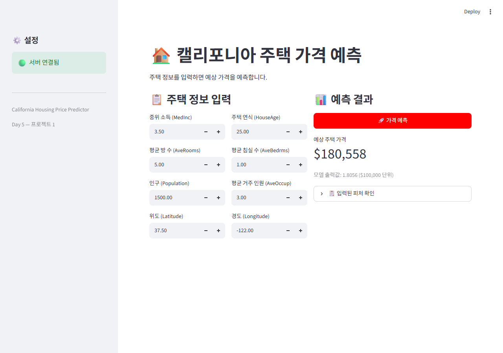
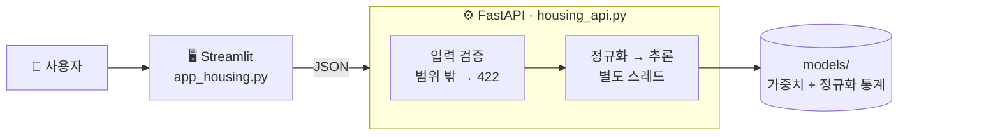

# 🏠 캘리포니아 집값 예측 API

> 동네 정보 8가지를 넣으면 **중위 주택 가격**을 돌려주는 서비스. 모델 학습부터 저장, API, 웹 화면, 통합 테스트까지 한 번에 이었습니다.



## 1. 한눈에

| 항목 | 내용 |
|---|---|
| 데이터 | scikit-learn California Housing (20,640행, 피처 8개, 타겟 단위 $100,000) |
| 모델 | PyTorch MLP 8 → 64 → 32 → 1 (ReLU, Dropout 0.2), Adam lr 0.001, 50 epoch, 배치 256 |
| 성능 | 테스트 MAE **0.3829 (약 $38,288)** |
| 서버 | FastAPI `GET /health`, `POST /predict` (Swagger : `/docs`) |
| 화면 | Streamlit — 피처 입력 → 예측 가격 |
| 비교용 | scikit-learn `StandardScaler + MLPRegressor` 파이프라인 + API Key 인증 (`app/tabular_api.py`), MAE 0.3666 (약 $36,660) |

## 2. 구조



| 파일 | 역할 |
|---|---|
| `housing.ipynb` | 학습 → 저장 → 모듈화 → 서버 → 화면 → 통합 테스트 전체 실행 기록 |
| `app/housing_model.py` | `HousingModel`(학습과 같은 구조) + `HousingPredictor`(로드 · 정규화 · 추론) |
| `app/housing_schemas.py` | 요청 · 응답 규격. 위도 32~42, 경도 -125~-114, 소득 > 0 등 범위 제한 |
| `app/housing_api.py` | 서버. 시작할 때 모델을 한 번만 올리고, 추론은 스레드풀(4개)에서 실행 |
| `app/tabular_api.py` | 같은 문제를 scikit-learn 파이프라인으로 푼 비교판. `X-API-Key` 인증 포함 |
| `app/logger_config.py` · `error_handlers.py` · `middleware.py` | 로그, 전역 에러 처리(내부 정보는 응답에 싣지 않음), 요청 로그 |
| `frontend/app_housing.py` | Streamlit 화면. 사이드바에 서버 연결 상태 표시 |
| `models/` | `housing_model.pth`(가중치 13KB) + `housing_preprocessing.json`(학습 데이터 평균 · 표준편차, 피처 순서) |

## 3. 신경 쓴 점

- **정규화 통계는 학습 데이터에서만 구했습니다.** 테스트 데이터 통계를 쓰면 평가에 미래 정보가 섞입니다(데이터 누수).
- **모델과 함께 정규화 통계를 저장했습니다.** 서버가 학습 때와 똑같이 정규화하지 않으면, 에러 없이 엉뚱한 가격이 나옵니다.
- **잘못된 입력은 모델에 닿기 전에 막습니다.** 필드 누락, 위도 50도, 소득 음수, JSON 이 아닌 본문은 모두 422 입니다.
- **추론은 별도 스레드에서 돌립니다.** 그동안에도 서버가 `/health` 같은 다른 요청에 응답합니다.

## 4. 테스트 결과 (노트북 11장)

| 테스트 | 결과 |
|---|---|
| 입력에 따른 예측 | 저소득 지역 $110,289 < 평균 $180,558 < 고소득 지역 $381,807 |
| 에러 입력 4종 | 필드 누락 · 위도 범위 초과 · 소득 음수 · 잘못된 형식 → 모두 422, 서버 생존 |
| 동시 요청 8개 | 모두 200, 전체 0.03초 |
| 헬스체크 | 테스트 후에도 `healthy` |

비교판(`tabular_api.py`)은 키 없음 401, 필드 누락 · 위도 초과 · 소득 음수 422 를 확인했습니다. 소득만 3.5 → 9.0 으로 올리면 예측이 $199,217 → $352,614 로 따라 오릅니다.

## 5. 실행

```bash
pip install -r requirements.txt

# 터미널 1 : API (http://localhost:8000/docs)
uvicorn app.housing_api:app --port 8000
# 비교판을 띄우려면 : uvicorn app.tabular_api:app --port 8000  (키 : dev-key-001)

# 터미널 2 : 화면 (http://localhost:8501)
streamlit run frontend/app_housing.py --server.port 8501
```

API 주소가 다르면 `API_BASE=http://주소:포트` 환경 변수로 화면에 알려 줍니다.

## 6. 회고

- 노트북 2.1절의 실험 셀(`random_state` 를 42 · 100 · 123 으로 바꿔 보기)이 학습 · 테스트 분할을 **마지막 값 123 으로 덮어썼습니다.** 그래서 저장된 모델은 seed 123 분할로 학습됐습니다. 노트북에 주석으로 남겼고, 다음에는 실험 셀이 본 변수를 건드리지 않게 이름을 따로 쓰겠습니다.
- PyTorch MLP(MAE $38,288)와 scikit-learn 파이프라인(MAE $36,660)은 분할이 달라(seed 123 / 42) 그대로 비교할 수는 없습니다. 같은 분할로 다시 재 보는 것이 다음 할 일입니다.
- scikit-learn 판은 전처리와 모델이 파이프라인 하나로 저장돼서, "정규화 통계를 따로 챙기는" 실수가 구조적으로 생기지 않았습니다.
