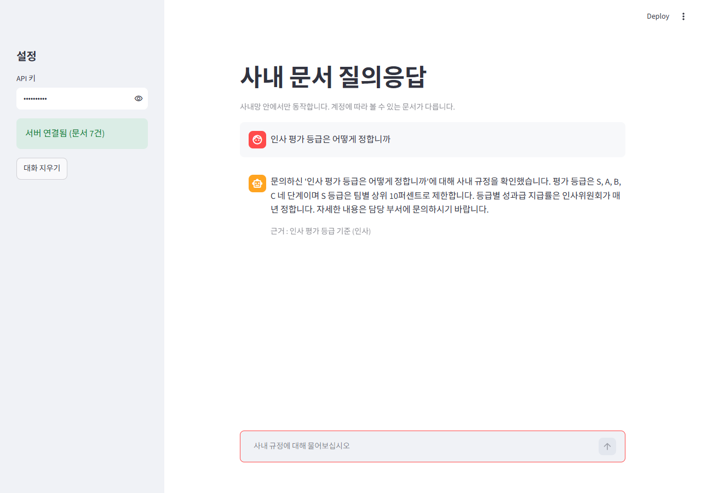
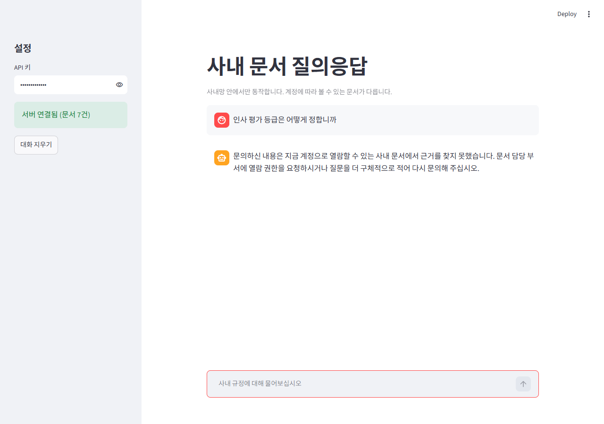
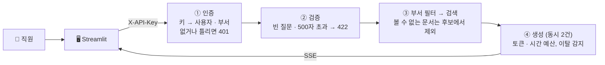

# 🏢 사내 문서 질의응답 서비스

> 직원이 사내 규정을 물으면 **자기 부서가 볼 수 있는 문서 안에서만** 근거를 찾아 답하고, 답을 한 토큰씩 스트리밍하는 서비스의 서빙 뼈대

| 인사 계정 : 인사 문서를 근거로 답함 | 영업 계정 : 같은 질문에 "근거를 찾지 못했다" |
|---|---|
|  |  |

## 1. 한눈에

| 항목 | 내용 |
|---|---|
| 목표 | LLM 을 사내 서비스로 올릴 때 필요한 **서빙 층**(인증 · 권한 · 검증 · 스트리밍 · 취소 · 동시 처리 제한 · 용량 산정)을 먼저 완성 |
| 생성부 | **진짜 LLM 이 아닌 대역(mock)** 입니다. 근거 문서로 답 문장을 만들고, 초당 20토큰 속도로 흘려보냅니다. 진짜 모델로 바꾸는 자리는 `app/inference.py` 의 `generate_tokens()` 한 곳 |
| 검색 | 두 글자 겹침(bigram) 점수. 실제 서비스에서는 벡터 검색 + 메타데이터 필터 자리 |
| 문서 | `data/사내문서.json` 7건 (공개 3 · 인사 2 · 영업 1 · 개발 1) |
| 서버 | FastAPI `GET /health` · `GET /stats` · `POST /ask` · `POST /ask/sse` |
| 화면 | Streamlit 채팅 화면. 답은 스트리밍, 아래에 근거 문서 제목 · 부서 표시 |
| 검증 | 채점기 `grade.py` **12개 항목 모두 통과** |

## 2. 요청 흐름



| 계정 (실습용 키) | 볼 수 있는 부서 |
|---|---|
| `dev-key-001` 김개발 | 공개, 개발 |
| `sales-key-002` 이영업 | 공개, 영업 |
| `hr-key-003` 박인사 | 공개, 인사 |
| `partner-key-004` 협력사 | 공개 |

## 3. 설계 원칙

1. **권한은 검색 '전에' 겁니다.** `retrieve()` 첫 줄이 부서로 문서를 거릅니다. 점수를 먼저 매기고 나중에 거르면, 볼 수 없는 문서가 프롬프트에 들어갈 수 있습니다.
2. **모르면 불합격.** 부서 정보가 없는 사용자는 아무 문서도 보지 못합니다. 응답 직전에 `in_scope()` 로 한 번 더 확인합니다.
3. **권한 밖 질문에 403 을 주지 않습니다.** 200 과 함께 "근거를 찾지 못했다"고 답합니다. 403 은 "그런 문서가 있다"는 사실까지 알려 주기 때문입니다.
4. **내부 오류는 감춥니다.** 500 응답에는 한 줄만 싣고, 상세 내용과 스택은 서버 로그에만 남깁니다.
5. **GPU 를 아낍니다.** 동시 생성은 2건(`CapacityLimiter`)으로 묶고, 요청마다 토큰 500개 · 30초 예산을 둡니다. 사용자가 창을 닫으면 10토큰마다 확인해 생성을 멈춥니다.
6. **설정은 환경 변수로 뺐습니다.** 키 목록, 동시 처리 수, 예산, 문서 경로 모두 `D52_*` 로 바꿀 수 있습니다.

## 4. 채점 결과 (`python -c "import grade; grade.run('http://127.0.0.1:8452')"`)

| # | 항목 | 기준 | 측정 |
|---|---|---|---|
| 1 | 헬스체크 | 200, 0.5초 이내 | 200, 0.02초 |
| 2 | 정상 질의 | 200, 답변 30자 이상 | 200, 130자 |
| 3 | 근거 표시 | sources 1건 이상 | 1건 |
| 4 · 5 | 키 없음 · 잘못된 키 | 401 | 401 |
| 6 | 부서 밖 문서 | 영업 0건 / 인사 1건 이상 | 영업 계정 0건, 인사 계정 1건 |
| 7 · 8 | 빈 질문 · 너무 긴 질문 | 422 | 422 |
| 9 | 내부 오류 | 500, 내부 정보 노출 0곳 | 500, 노출 없음 |
| 10 | 동시 10건 | 모두 200, 서버 생존 | 10/10, 10.2초 |
| 11 | 스트리밍 | 첫 청크 1초 이내 | 0.08초, 청크 40개 |
| 12 | 취소 | 끊으면 절반 미만에서 멈춤 | 44토큰 중 17토큰에서 멈춤 |

## 5. 몇 명까지 받을 수 있나

두 숫자를 따로 구하고 **작은 쪽**을 서비스 한계로 봤습니다.

| 기준 | 값 | 근거 |
|---|---|---|
| 계산 (VRAM) | 40명 | 16GB GPU, 7B급 int4 모델(가중치 4.94GB), 시퀀스 4096 → 1인당 KV 캐시 0.235GB |
| 실측 (응답 시간 6초 목표) | 4명 | 동시 1 · 2 · 4명 통과, 8명은 최대 8.9초로 초과 |
| **서비스 한계** | **4명** | 메모리보다 **동시 처리 칸 수(2칸)** 가 먼저 막힘 |

코드를 고치지 않고 `D52_GPU_SLOTS=8` 로 칸만 늘리자 동시 8명도 최대 2.3초에 끝났습니다. 다만 이 측정은 대역 생성기라 칸을 늘려도 느려지지 않습니다. 진짜 GPU 에서는 칸을 늘리면 한 건씩 느려지므로, 모델을 붙인 뒤 다시 재야 합니다.

## 6. 실행

```bash
pip install -r requirements.txt

# 터미널 1 : API (http://127.0.0.1:8452/docs)
uvicorn app.main:app --port 8452

# 터미널 2 : 화면 (http://localhost:8501)
streamlit run frontend/app.py --server.port 8501   # 다른 주소면 D52_API_BASE 환경 변수

# 채점
python -c "import grade; grade.run('http://127.0.0.1:8452')"
```

`qa_service.ipynb` 에 부품 만들기부터 채점, 부하 테스트까지의 실행 기록이 있습니다.

## 7. 회고

- LLM 없이도 **서비스의 절반 이상이 정해진다**는 걸 알았습니다. 누가 무엇을 볼 수 있는지, 언제 멈추는지, 몇 명까지 받는지는 모델과 상관없이 서빙 층이 정합니다.
- 계산한 한계(40명)와 잰 한계(4명)가 10배 차이 났습니다. 메모리만 보고 용량을 잡았다면 크게 틀렸을 겁니다.
- 다음 할 일 : 생성부를 실제 모델(TextIteratorStreamer)로, 검색부를 벡터 검색으로 바꾸고 같은 채점기로 다시 재기.
