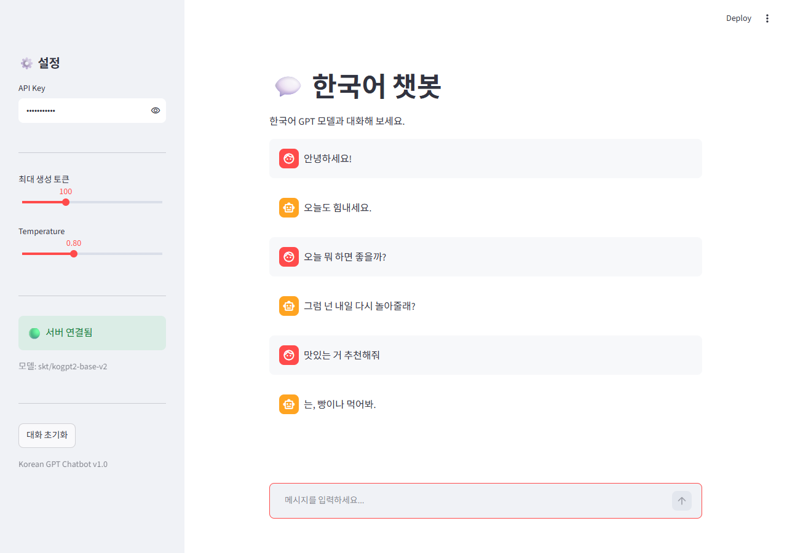
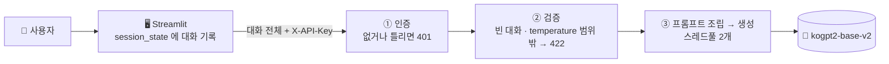

# 💬 트랜스포머(GPT) 한국어 챗봇 서비스

> 허깅페이스의 한국어 GPT 모델을 FastAPI 로 서빙하고, API Key 인증과 Streamlit 채팅 화면을 붙인 멀티턴 챗봇



## 1. 한눈에

| 항목 | 내용 |
|---|---|
| 모델 | [`skt/kogpt2-base-v2`](https://huggingface.co/skt/kogpt2-base-v2) — GPT-2 구조(트랜스포머 디코더), 파라미터 1.25억 개, CPU 로 동작 |
| 서버 | FastAPI `GET /health`, `POST /chat` (`X-API-Key` 인증) |
| 화면 | Streamlit `st.chat_input` · `st.chat_message`, 사이드바에서 최대 토큰 · temperature 조절 |
| 대화 방식 | 서버는 대화를 기억하지 않습니다(stateless). 화면이 지난 대화를 매번 함께 보냅니다 |
| 라이선스 | CC BY-NC-SA 4.0 — **비영리 조건**이 있어 사내 · 상업 서비스에는 그대로 쓸 수 없습니다 |

## 2. 구조



| 파일 | 역할 |
|---|---|
| `chatbot.ipynb` | 모델 시험 → 서버 파일 작성 → 화면 → 통합 테스트 실행 기록 |
| `app/chatbot_model.py` | `ChatbotModel` : 대화 → `사용자: … / 봇:` 프롬프트 → 생성 → 봇의 한 줄만 잘라 돌려줌 |
| `app/chatbot_schemas.py` | 요청 규격. 메시지 1개 이상, `max_new_tokens` 10~500, `temperature` 0 초과 2 이하 |
| `app/chatbot_api.py` | 서버. 시작할 때 모델을 한 번 올리고, 생성은 스레드풀(2개)에서 실행 |
| `app/auth.py` | API Key → 사용자 · 부서 |
| `frontend/app_chatbot.py` | 채팅 화면. 서버 상태와 모델 이름을 사이드바에 표시 |

## 3. 만들면서 고친 것

| 문제 | 고친 것 |
|---|---|
| 옵션 없이 생성하니 같은 말을 끝없이 반복 ("로우: 괜찮아요." 가 여러 줄) | `repetition_penalty=1.3`, `no_repeat_ngram_size=3` |
| 모델이 사용자 대사까지 이어 씀 | `사용자:` 가 나오면 자르고, 봇의 한 턴은 **첫 줄만** 씀 |
| attention mask · pad token 경고 | `attention_mask`, `pad_token_id` 를 명시 |
| 서버 실행 셀이 포트 충돌로 실패해도 "서버 시작됨" 출력 | 포트가 쓰이는지 먼저 확인하고, `time.sleep` 대신 `/health` 가 `healthy` 가 될 때까지 기다림 |
| 통합 테스트 셀이 모두 주석 | 주석을 풀고 실행해 결과를 남김 |
| 대화가 길어지면 모델 최대 길이(1,024토큰) 초과 | 앞부분을 잘라 **최근 대화만** 남김 |

## 4. 테스트 결과

| 테스트 | 결과 |
|---|---|
| 인증 | 키 없음 401, 잘못된 키 401, 올바른 키 200 |
| 멀티턴 3회 | 3턴 모두 200, 대화 기록이 쌓여 전달됨 |
| 입력 검증 | 빈 메시지 목록 422, temperature 초과 422 |
| 동시 요청 4개 | 모두 200. 2.5초 · 2.4초 · 5.6초 · 5.6초 — 스레드가 2개라 **두 건씩** 처리됨 |

## 5. 실행

```bash
pip install -r requirements.txt     # 첫 실행 때 모델 약 0.5GB 를 내려받습니다

# 터미널 1 : API (http://localhost:8000/docs)
uvicorn app.chatbot_api:app --port 8000

# 터미널 2 : 화면 (http://localhost:8501), 키 : dev-key-001
streamlit run frontend/app_chatbot.py --server.port 8501
```

## 6. 회고

- 답이 엉뚱합니다. "맛있는 거 추천해줘" 에 "아빠가 만들어준 빵을 먹었다" 처럼 답합니다. kogpt2-base 는 **대화용으로 다듬지 않은 언어 모델**이라, 주어진 글을 그럴듯하게 이어 쓸 뿐 질문에 답하도록 배우지 않았기 때문입니다. 서빙 구조와 모델 품질은 별개의 문제라는 걸 확인했습니다.
- 그래서 모델을 `ChatbotModel` 클래스 하나로 감쌌습니다. 지시를 따르도록 학습된 모델(예 : 상업 이용이 가능한 Qwen2.5-Instruct)로 바꿀 때 고칠 곳은 이 파일 하나입니다.
- 서버가 대화를 기억하지 않으니 서버를 여러 대로 늘리기 쉽습니다. 대신 대화가 길어질수록 요청이 커지므로, 최근 대화만 남기는 처리가 꼭 필요했습니다.
